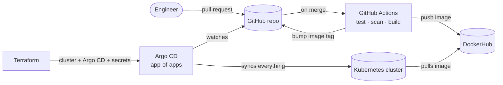
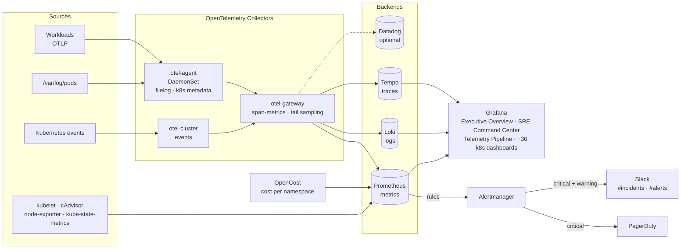

# Observability Lab — end-to-end Kubernetes observability, delivered by GitOps

A production-shaped observability platform for Kubernetes. It is **CNCF-first**, **OpenTelemetry-native** and **fully GitOps-managed**. It covers **metrics, logs, traces and Kubernetes events**, with two purpose-built dashboards and an incident-management integration. It runs on a laptop (kind), on **EKS** or **GKE**, or **plugs into an existing cluster** with one Terraform/Argo CD call.

### Delivery (GitOps)



### Telemetry (inside the cluster)



## Technology choices

| Concern | Choice | CNCF | Why |
|---|---|---|---|
| GitOps | **Argo CD** (app-of-apps, sync waves, self-managed) | Graduated | De-facto GitOps standard, UI for operators |
| IaC | **Terraform** (kind / EKS / GKE) | — | Industry default; one bootstrap module for every cluster |
| CI | **GitHub Actions** → **DockerHub** | — | Test, Trivy scan, multi-arch build, SBOM/provenance, GitOps promotion |
| Telemetry pipeline | **OpenTelemetry Collector** (agent + gateway + cluster) | Incubating | Vendor-neutral; one pipeline for all signals; dual-ship to Datadog |
| Auto-instrumentation | **OpenTelemetry Operator** | Incubating | Zero-code onboarding with **one annotation** (Java/Python/Node/.NET/Go) |
| Metrics | **Prometheus** + Operator (kube-prometheus-stack) | Graduated | Native OTLP ingest, ~150 battle-tested k8s alerts |
| Logs | **Grafana Loki** (native OTLP) | — | Cheap object-storage logs, label model matches Prometheus |
| Traces | **Grafana Tempo** (TraceQL) | — | Object storage only, deep Grafana correlation |
| Events | OTel `k8sobjects` → Loki | — | Kubernetes events kept for 31 days and searchable (the API server keeps them for only 1 h) |
| Visualisation | **Grafana** | — | Metrics ⇄ logs ⇄ traces correlation (exemplars, derived fields) |
| SLOs | Multi-window multi-burn-rate rules | — | Google SRE Workbook method, auto-generated for every service |
| Alerting / incidents | **Alertmanager** → **PagerDuty** + **Slack** | Graduated | Routing, grouping, inhibition, runbook links |
| FinOps | **OpenCost** | Incubating | Cost per namespace / idle spend for stakeholders |
| Commercial (optional) | **Datadog** (Operator + OTel exporter) | — | Toggle on to dual-ship; no lock-in |
| Ingress & TLS | **Envoy Gateway** (Gateway API) + **cert-manager** | Graduated (cert-manager), Envoy | One HTTPS entry point; Let's Encrypt in the cloud, lab CA on kind |
| Single sign-on | **Keycloak** (OIDC) → Grafana + Argo CD | Incubating | Groups → roles: `sre-team` = admin, `stakeholders` = viewer |

Why these choices and what the alternatives were (Jaeger, Fluent Bit, Thanos/Mimir, Elastic, Opsgenie…): [docs/adr/0001-technology-choices.md](docs/adr/0001-technology-choices.md).

## Quick start (local, ~10 min)

**Prerequisites:** Docker with **≥ 8 GB free for the cluster** (the full stack uses ~5–6 GB), `kind`, `kubectl`, `helm`, `terraform ≥ 1.6`, and a GitHub fork of this repo. Argo CD pulls from Git, so the repo must be reachable.

```bash
# 1. personalise placeholders (repo URLs, runbook links, image name) and push
scripts/configure-repo.sh <github-owner> <dockerhub-user>
git add -A && git commit -m "configure" && git push

# 2. create kind cluster + Argo CD + root app (+ builds/loads the demo image)
cp terraform/envs/kind/terraform.tfvars.example terraform/envs/kind/terraform.tfvars   # edit gitops_repo_url
make up

# 3. watch Argo CD roll everything out in waves, then open the UIs
make status
make sso-users     # SSO logins: alice (sre-team → admin) · bob (stakeholders → viewer)
make lab-ca        # optional: trust the lab CA to silence browser warnings
make ui            # port-forward Prometheus :9090 · Alertmanager :9093 · OpenCost :9091
```

Open **https://grafana.127.0.0.1.nip.io** and **https://argocd.127.0.0.1.nip.io** and sign in with Keycloak. The local `admin` accounts (`make grafana-password`, `make argocd-password`) remain as break-glass access. Details: [docs/sso.md](docs/sso.md).

Grafana → **Dashboards → Executive / SRE**. Then run a game day:

```bash
make chaos-errors      # 20 % payment failures → SLO burn-rate alert → PagerDuty + Slack
make chaos-latency     # +800 ms → latency SLO alert, slow traces in Tempo
make chaos-reset
```

### Cloud

```bash
make up ENV=eks        # VPC + EKS + S3 + IRSA + bootstrap   (terraform/envs/eks)
make up ENV=gke        # VPC + GKE + GCS + Workload Identity (terraform/envs/gke)
```
Then copy the bucket and role outputs into `gitops/platform/{loki,tempo}/values-<env>.yaml`, set your domain, DNS and a PostgreSQL database for Keycloak ([docs/sso.md](docs/sso.md#eks--gke)). Cloud environments switch to HA settings: Loki Distributed, tempo-distributed, 2× Prometheus, 3× Alertmanager, and an autoscaled OTel gateway.

### Existing cluster (brownfield)

See **[docs/onboarding-existing-cluster.md](docs/onboarding-existing-cluster.md)**. In short, run `scripts/create-secrets.sh` and point your Argo CD at `gitops/root` with `values-existing.yaml`. Then onboard workloads with one annotation:

```yaml
instrumentation.opentelemetry.io/inject-java: "observability/default"
```

## The two dashboards

| | **Executive Overview** (`/d/executive-overview`) | **SRE Command Center** (`/d/sre-command-center`) |
|---|---|---|
| Audience | Stakeholders, management, product | On-call SREs, platform engineers |
| Window | 30 days, refresh 5 min | 3 hours, refresh 30 s |
| Answers | *Are we reliable? Can we ship faster? What does it cost?* | *What is broken, where, since when, and why?* |
| Content | Availability vs 99.5 % SLO, error budget per service, open incidents, time in incident, requests / orders / revenue, DORA (deploy frequency, change-failure rate), monthly cost, cost per namespace, idle spend, capacity | Firing alerts, golden signals per service with exemplars → traces, burn rates, live service map, pod/node health, restarts/OOM, throttling, volumes, error logs (→ trace), k8s warning events, failed & slow traces, Argo CD state |

A third dashboard, **Telemetry Pipeline Health**, watches the monitoring stack itself (collector drops, queue fill, ingestion, failed notifications). kube-prometheus-stack adds ~30 standard Kubernetes dashboards.

## Repository layout

```
terraform/
  modules/argocd-bootstrap/   namespaces, secrets, Argo CD, root app — reused by every env
  envs/{kind,eks,gke}/        cluster + storage + identity, then the bootstrap module
gitops/
  root/                       app-of-apps chart: component catalog + per-env toggles
  platform/<component>/       Helm values: values.yaml (common) + values-<env>.yaml
  observability-config/       dashboards, SLO & alert rules, datasources, Instrumentation CR
  apps/demo-shop/             sample workload (kustomize base + overlays)
  addons/datadog/             optional DatadogAgent CR
apps/demo-shop/               source of the sample 3-tier app (FastAPI, zero OTel code)
.github/workflows/            CI: app build/push/promote, GitOps validation, Terraform, e2e on kind
docs/                         architecture, onboarding, SSO, incident management, runbooks, ADRs
scripts/                      render, dashboards-as-code, secrets, port-forward, chaos
```

## Production readiness checklist

- [x] Everything declarative and in Git; Argo CD self-heals drift and manages itself
- [x] Chart versions pinned in one catalog (`gitops/root/values.yaml`), bumped by Renovate
- [x] Secrets never in Git (Terraform / `create-secrets.sh`; swap for External Secrets in prod)
- [x] Resource requests/limits, PDBs, topology spread and HA replicas in cloud environments
- [x] Object storage with IRSA / Workload Identity (no static keys), encryption, lifecycle rules
- [x] Tail sampling keeps 100 % of errors and slow traces; span-metrics are computed **before** sampling
- [x] Back-pressure: `memory_limiter`, persistent queues, retries, checkpointed log tailing
- [x] Meta-monitoring: alerts + dashboard for the telemetry pipeline itself
- [x] Every alert carries `runbook_url` + `dashboard_url`; critical alerts page, warnings go to Slack
- [x] CI renders every environment and validates it with the real binaries (kubeconform, otelcol, promtool, amtool)
- [x] SSO for Grafana and Argo CD through Keycloak (OIDC), group → role mapping, break-glass local admins ([docs/sso.md](docs/sso.md))
- [x] Gateway API ingress (Envoy Gateway) with TLS from cert-manager; unauthenticated UIs (Prometheus, Alertmanager) stay internal
- [ ] Your domain + DNS, and PostgreSQL for Keycloak in the cloud ([docs/sso.md](docs/sso.md#eks--gke))
- [ ] Long-term metrics (Thanos / Mimir / managed Prometheus remote-write — see `values-eks.yaml`)
