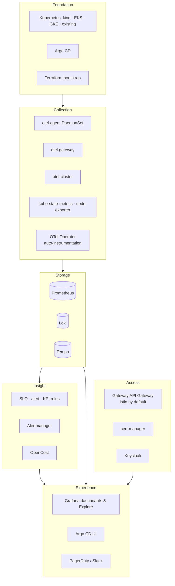
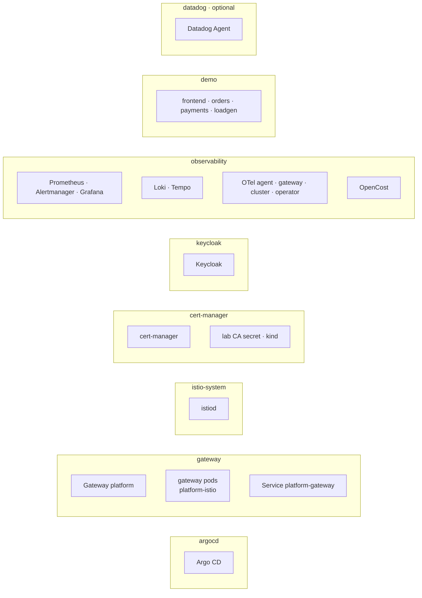

# 1. Overview

## 1.1 Goals

| Goal | How the architecture meets it |
|---|---|
| **Full-stack visibility** | Metrics, logs, traces *and* Kubernetes events, from nodes, the control plane, platform components and applications |
| **Vendor neutrality** | OpenTelemetry end to end; backends are configuration (`otel-gateway` exporters), not code. Commercial tools (Datadog) are an optional second destination |
| **Zero-effort onboarding** | One pod annotation gives a workload traces, RED metrics, log ↔ trace links and an SLO |
| **Everything in Git** | Argo CD reconciles the whole platform, including itself; Terraform only bootstraps |
| **Portable** | The same Git tree runs on kind, EKS, GKE or a brownfield cluster; only `values-<env>.yaml` differs |
| **Actionable** | SLO burn-rate alerts with runbook and dashboard links, routed to PagerDuty and Slack |
| **Secure access** | One HTTPS entry point, SSO through Keycloak, role per group, unauthenticated UIs kept internal |
| **Cost-aware** | OpenCost per namespace, tail sampling, low-cardinality labels, object storage for logs and traces |

## 1.2 Principles

1. **CNCF first.** Prefer graduated/incubating projects with open standards (OTLP, PromQL, Gateway API, OIDC).
2. **One pipeline for all signals.** A single OpenTelemetry pipeline instead of one agent per signal.
3. **Compute before you drop.** RED metrics are derived from *all* spans before tail sampling, so sampling never skews SLOs.
4. **Declarative or not at all.** No manual `kubectl apply`. Secrets are the only out-of-Git objects, and they have a fixed contract (name + keys).
5. **Layered configuration.** Common `values.yaml` + `values-<env>.yaml`; components are toggled in one catalog.
6. **Pluggable edges.** Gateway implementation, identity provider, incident tool and commercial backend are each one setting or one file.

## 1.3 Layers



## 1.4 Component catalog

The single source of truth is [`gitops/root/values.yaml`](../gitops/root/values.yaml). Each entry becomes one Argo CD `Application`.

| Component | What it is | Chart / source | Namespace | Wave | Default |
|---|---|---|---|---|---|
| `argocd` | GitOps controller, manages itself | argo-cd 10.20.0 | argocd | -10 | on (off in `existing`) |
| `gateway-api` | Gateway API CRDs, standard channel v1.6.3 | upstream release (kustomize) | gateway | -8 | on |
| `istio-base` | Istio CRDs and cluster RBAC | istio base 1.30.8 | istio-system | -7 | provider `istio` |
| `istiod` | Gateway API controller (no sidecars) | istiod 1.30.8 | istio-system | -6 | provider `istio` |
| `envoy-gateway-crds` | Envoy Gateway CRDs | gateway-crds-helm 1.10.0 (OCI) | envoy-gateway-system | -7 | provider `envoy` |
| `envoy-gateway` | Alternative Gateway API controller | gateway-helm 1.10.0 (OCI) | envoy-gateway-system | -6 | provider `envoy` |
| `cert-manager` | TLS certificates for Gateway listeners | cert-manager v1.21.3 | cert-manager | -5 | on |
| `ingress` | Shared Gateway, issuer, routes (local chart) | `gitops/platform/ingress` | gateway | -4 | on |
| `kube-prometheus-stack` | Prometheus Operator, Prometheus, Alertmanager, Grafana, node-exporter, kube-state-metrics, ~150 rules | 93.11.1 | observability | 0 | on |
| `loki` | Log store (OTLP native) | loki 7.7.0 | observability | 1 | on |
| `tempo` | Trace store (TraceQL) | tempo 1.24.4 (kind) / tempo-distributed 1.61.3 | observability | 1 | on |
| `otel-operator` | `Instrumentation` CRD, auto-instrumentation injection | opentelemetry-operator 0.129.2 | observability | 1 | on |
| `keycloak` | Identity provider for SSO | keycloakx 7.4.0 (Keycloak 26.8) | keycloak | 1 | on |
| `otel-gateway` | Central collector: span-metrics, tail sampling, fan-out | opentelemetry-collector 0.183.2 | observability | 2 | on |
| `opencost` | Cost allocation | opencost 2.5.35 | observability | 2 | on |
| `otel-agent` | Node collector: OTLP endpoint, container logs, k8s metadata | opentelemetry-collector 0.183.2 | observability | 3 | on |
| `otel-cluster` | Cluster-singleton collector: Kubernetes events | opentelemetry-collector 0.183.2 | observability | 3 | on |
| `observability-config` | Dashboards, SLO/alert/KPI rules, datasources, `Instrumentation` | kustomize overlays | observability | 4 | on |
| `datadog-operator`, `datadog-agent` | Optional commercial destination | datadog-operator 2.33.0 + CR | datadog | 1, 2 | off |
| `demo-shop` | Sample 3-tier workload + load generator | kustomize overlays | demo | 5 | on (off in `existing`) |

## 1.5 Namespaces



`observability` is labelled `pod-security.kubernetes.io/enforce=privileged` because node-exporter and the log agent read host paths. All other namespaces use the cluster default.

## 1.6 Repository map

```
terraform/
  modules/argocd-bootstrap/   namespaces, secrets, Argo CD, root app (all envs)
  envs/{kind,eks,gke}/        cluster, storage, identity → bootstrap module
gitops/
  root/                       app-of-apps chart: component catalog + per-env toggles
  platform/<component>/       Helm values (values.yaml + values-<env>.yaml) or local charts
  observability-config/       dashboards, rules, datasources, Instrumentation (kustomize)
  apps/demo-shop/             sample workload (kustomize base + overlays)
  addons/datadog/             DatadogAgent CR
apps/demo-shop/               sample app source (FastAPI, no OTel code)
scripts/                      render, dashboards-as-code, secrets, SSO test, chaos
.github/workflows/            app CI, GitOps validation, Terraform checks, e2e on kind
docs/                         guides, runbooks, ADRs
architecture/                 this reference
```
