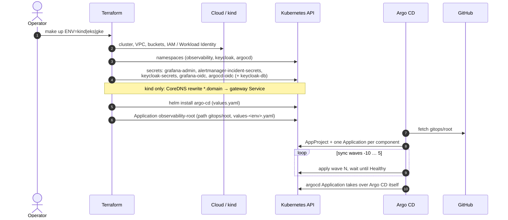
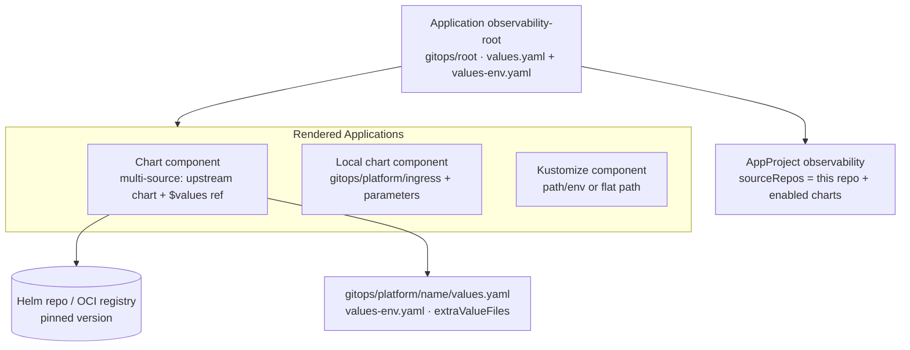
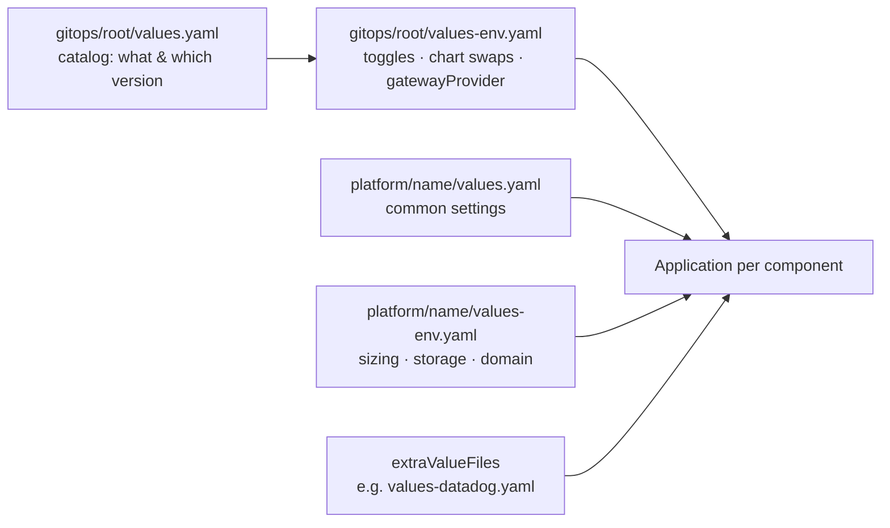
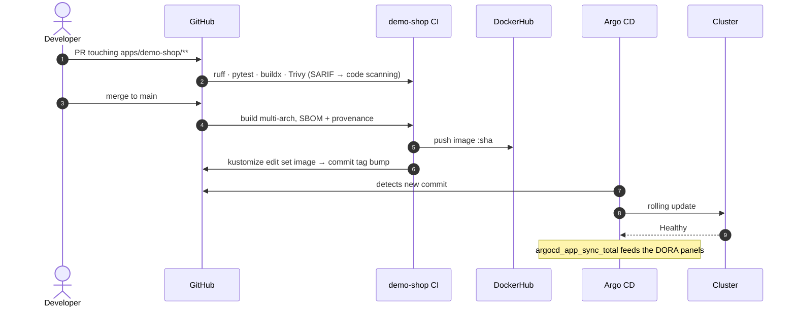

# 2. Delivery & GitOps

## 2.1 Responsibilities

| Actor | Does | Never does |
|---|---|---|
| **Terraform** | Creates the cluster (kind/EKS/GKE), networks, buckets, cloud identities; once: namespaces, out-of-Git secrets, Argo CD, the root Application | Deploy or update platform components after bootstrap (`ignore_changes = all` on the Argo CD release) |
| **Argo CD** | Renders `gitops/root`, creates one Application per enabled component, syncs them in waves, self-heals drift, prunes removed objects, manages its own installation | Read secrets from Git (there are none) |
| **GitHub Actions** | Tests, scans and builds images; validates every GitOps change with the real binaries; bumps image tags **in Git** | Talk to the cluster (no kubeconfig in CI) |
| **Renovate** | Opens PRs for chart versions, OCI charts, the Gateway API release and the Terraform-pinned Argo CD chart | Merge major upgrades without approval |

## 2.2 Bootstrap

The bootstrap module ([`terraform/modules/argocd-bootstrap`](../terraform/modules/argocd-bootstrap)) is shared by every environment. With `install_argocd = false` it reuses an Argo CD that already runs (brownfield).

## 2.3 App-of-apps

The root chart ([`gitops/root/templates/applications.yaml`](../gitops/root/templates/applications.yaml)) knows three kinds of component:

| Kind | Catalog keys | Source in the Application |
|---|---|---|
| Upstream chart | `chart: {repoURL, name, version}`, `valuesDir`, `extraValueFiles` | Multi-source: the chart + this repo as `$values`; value files `values.yaml`, `values-<env>.yaml`, extras. `ignoreMissingValueFiles` makes env files optional. OCI charts use a scheme-less `repoURL` (`docker.io/envoyproxy`) |
| Local chart | `chartPath` | This repo at `chartPath`, value files relative to the chart, plus the parameter `global.gatewayProvider` |
| Kustomize | `path` (+ `/<env>` unless `pathIsFlat`) | This repo at that path |

Every Application gets the shared sync policy (automated, prune, self-heal, retries with back-off), `CreateNamespace=true`, and optional per-component `syncOptions` (`ServerSideApply`, `RespectIgnoreDifferences`, …), `syncPolicy` overrides (Argo CD never prunes itself) and `ignoreDifferences` (Istio webhooks patched at runtime).

**Gating.** A component renders when `enabled: true` **and**, if it carries `gatewayProvider: <x>`, when `global.gatewayProvider == x`. The same rule builds the AppProject's `sourceRepos`, so only charts in use are allowed.

## 2.4 Sync waves

Argo CD waits for each wave to be **Healthy** before the next. The custom health check for `argoproj.io/Application` (in `argocd/values.yaml`) makes the root app wait on child health, so waves work across Applications.

| Wave | Components | Why this order |
|---|---|---|
| -20 | AppProject | Applications reference it |
| -10 | argocd | Self-management first |
| -8 | gateway-api | Everything ingress-related needs the CRDs |
| -7 | istio-base (or envoy-gateway-crds) | Controller CRDs |
| -6 | istiod (or envoy-gateway) | Programs Gateways |
| -5 | cert-manager | Its Gateway API shim needs the CRDs at start-up |
| -4 | ingress | Gateway, ClusterIssuer, HTTPRoutes |
| 0 | kube-prometheus-stack | Prometheus Operator CRDs (ServiceMonitor, PrometheusRule) used by everything after |
| 1 | loki, tempo, otel-operator, keycloak, datadog-operator | Backends and operators |
| 2 | otel-gateway, opencost, datadog-agent | Gateway needs backends to export to |
| 3 | otel-agent, otel-cluster | Agents need the gateway |
| 4 | observability-config | Dashboards, rules, `Instrumentation` CR (needs operator CRDs) |
| 5 | demo-shop | Needs the `Instrumentation` CR to be injected |

## 2.5 Configuration layering

Examples of environment differences carried purely by values: Tempo switches chart (`tempo` → `tempo-distributed`) in `values-eks.yaml`; Loki switches `deploymentMode`; Keycloak switches from dev mode (H2) to production mode (PostgreSQL); the ingress chart switches from `NodePort` + lab CA to `LoadBalancer` + Let's Encrypt.

## 2.6 Application CI/CD (demo-shop)

## 2.7 GitOps validation (every PR)

[`gitops-validate.yaml`](../.github/workflows/gitops-validate.yaml) renders **every environment** exactly as Argo CD would ([`scripts/render.py`](../scripts/render.py): root chart → each Application's chart, local chart or kustomize path), then checks the output with the binaries that run in the cluster:

| Check | Tool |
|---|---|
| Every Application renders | `helm template`, `kubectl kustomize` (`--strict`) |
| Manifests match Kubernetes + CRD schemas | kubeconform (1.34, CRDs catalog) |
| Collector configs are valid | `otelcol-contrib validate` (agent, gateway, cluster) |
| Alert and recording rules | `promtool check rules` |
| Alertmanager config | `amtool check-config` |
| Dashboards are valid and regenerated | `generate-dashboards.py` + `git diff --exit-code` |

[`terraform.yaml`](../.github/workflows/terraform.yaml) runs `fmt`, `validate`, tflint and a Trivy IaC scan. [`e2e-kind.yaml`](../.github/workflows/e2e-kind.yaml) (manual) builds a kind cluster from the commit, waits for every Application to be Synced/Healthy, asserts metrics, logs, events and traces are flowing, and runs the SSO smoke test.

## 2.8 Change, rollback and drift

* **Change** = a merged commit. Argo CD syncs within its polling interval (or on webhook).
* **Rollback** = `git revert` (preferred, keeps history) or Argo CD → History → Rollback for an emergency, then revert in Git.
* **Drift** = self-heal reverts manual edits; `ArgoCDAppOutOfSync` (30 min) and `ArgoCDAppDegraded` (15 min) alert on the rest.
* **Upgrades** = Renovate PRs, grouped weekly ("observability charts"); majors need dashboard approval. The PR is validated by the render pipeline above before merge.
