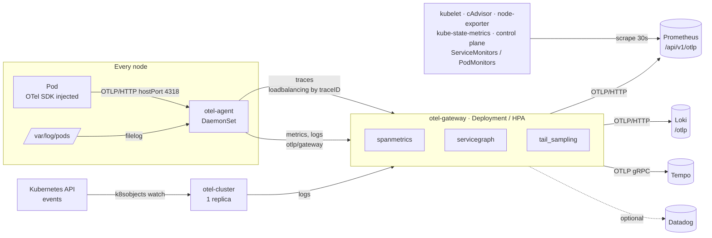
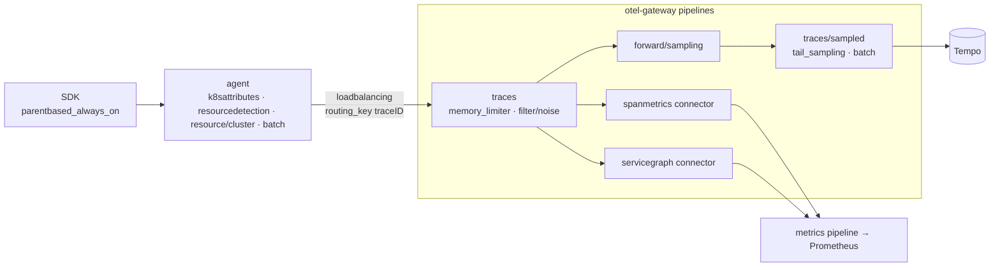
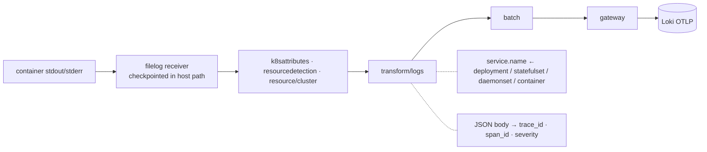
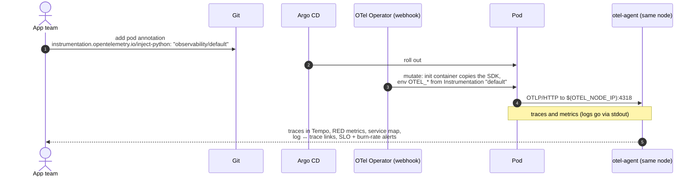

# 3. Telemetry pipeline

All application telemetry and Kubernetes events flow through **OpenTelemetry Collectors** in three roles. Infrastructure metrics (kubelet, cAdvisor, node-exporter, kube-state-metrics, control plane, platform ServiceMonitors) are scraped by Prometheus directly.

## 3.1 End-to-end view

## 3.2 The three collectors

| | **otel-agent** | **otel-gateway** | **otel-cluster** |
|---|---|---|---|
| Kind | DaemonSet (tolerates every taint) | Deployment; HPA 3–10 in the cloud | Deployment, **exactly 1** |
| Inputs | OTLP from pods on the node (hostPort 4317/4318), container logs (`filelog`, checkpointed) | OTLP from agents and otel-cluster | `k8sobjects` watch on events |
| Does | k8s metadata enrichment, resource detection, cluster/env labels, `service.name` fallback for logs, JSON log parsing (trace/span id, level) | Noise filter, **span-metrics + service graph from all spans**, **tail sampling**, batching, fan-out | Promotes event reason/type/object/namespace to attributes, severity mapping |
| Outputs | traces → `loadbalancing` (trace-ID affinity); metrics/logs → gateway | Prometheus, Loki, Tempo, (Datadog) | gateway |
| Why separate | Node-local endpoint (no cross-node hops), host log access | Central policy point; sampling needs every span of a trace on one replica | Events must be collected once, not once per node |

Configs: [`otel-agent/values.yaml`](../gitops/platform/otel-agent/values.yaml), [`otel-gateway/values.yaml`](../gitops/platform/otel-gateway/values.yaml), [`otel-cluster/values.yaml`](../gitops/platform/otel-cluster/values.yaml). CI validates each one with the real `otelcol-contrib` binary.

## 3.3 Traces

* **Sources keep 100 %** (`parentbased_always_on` in the `Instrumentation` CR). The decision to keep or drop is made once, centrally.
* **Noise filter:** spans for `/healthz`, `/readyz` and `/metrics` are dropped before anything else.
* **RED metrics before sampling:** `spanmetrics` emits `traces_span_metrics_calls_total` and `traces_span_metrics_duration_seconds` (buckets 5 ms … 10 s; dimensions method, route, status code; resource keys `service.name`, `k8s.namespace.name`) with **exemplars**. `servicegraph` emits caller → callee edges for the service map. Because both see every span, SLOs are exact regardless of sampling.
* **Tail sampling** (`decision_wait` 10 s, 50 000 traces in memory):

| Policy | Keeps |
|---|---|
| `keep-errors` | every trace with an `ERROR` status |
| `keep-slow` | every trace longer than 500 ms |
| `sample-rest` | 25 % of everything else |

Result: every trace you need for an incident is stored, at roughly a quarter of the storage cost.

## 3.4 Metrics

| Source | Path | Notes |
|---|---|---|
| Application SDK metrics (e.g. `shop.orders`, revenue) | SDK → agent → gateway → Prometheus OTLP receiver | Export interval 30 s |
| Span-metrics, service graph | gateway connectors → Prometheus OTLP | Basis for SLOs and RED panels |
| Kubernetes & nodes | Prometheus scrapes kubelet/cAdvisor, node-exporter, kube-state-metrics | Upstream kube-prometheus rules and dashboards |
| Control plane | etcd, scheduler, controller-manager, kube-proxy | kind exposes them via kubeadm patches; managed in EKS/GKE (disabled) |
| Platform components | ServiceMonitors/PodMonitors (collectors, Loki, Tempo, Argo CD, Keycloak, OpenCost…) | Discovered in **any** namespace (`*SelectorNilUsesHelmValues: false`) |

Prometheus promotes selected OTLP resource attributes to labels (`service.namespace`, `service.version`, `deployment.environment.name`, `k8s.cluster.name`, `k8s.namespace.name`, workload and pod/node names) and accepts samples up to 30 min out of order.

## 3.5 Logs

* Applications **log to stdout as JSON** with `trace_id` and `span_id`; the SDK log exporter is disabled (`OTEL_LOGS_EXPORTER=none`) so logs are not ingested twice.
* Loki stores `trace_id`/`span_id` as **structured metadata** (not labels). Only low-cardinality resource attributes become index labels: `k8s.cluster.name`, `deployment.environment.name`, `k8s.node.name` (plus Loki's defaults such as `service_name`, `k8s_namespace_name`).

## 3.6 Kubernetes events

The API server keeps events for about one hour. `otel-cluster` watches them and ships them as logs with `service_name="k8s-events"`, kept for Loki's retention (31 days in the cloud). Attributes `k8s.event.reason`, `k8s.event.type`, `k8s.object.kind/name` and the involved object's namespace make them filterable; `Warning` events get severity `WARN`. The SRE dashboard shows them next to error logs.

## 3.7 Enrichment model

| Attribute | Set by | Used for |
|---|---|---|
| `service.name` | SDK, else pod label `app.kubernetes.io/name`, else workload name (logs) | Grouping everywhere, SLO identity |
| `service.version` | pod label `app.kubernetes.io/version` | Deploy comparisons |
| `team` | namespace label `team` | Ownership |
| `k8s.namespace.name`, `k8s.pod.name`, `k8s.node.name`, workload names, container image | `k8sattributes` | Drill-down, joins with kube-state-metrics |
| `k8s.cluster.name`, `deployment.environment.name` | `resource/cluster` (per env) | Multi-cluster views |

## 3.8 Back-pressure and data safety

| Mechanism | Where | Protects against |
|---|---|---|
| `memory_limiter` (80 % / spike 25 %) | every pipeline | OOM kills; refuses data instead (`OTelCollectorRefusingData`) |
| `GOMEMLIMIT` from the container limit | all collectors | GC thrash near the limit |
| Sending queues (5 000) + retry on failure | agent → gateway, gateway → backends | Short backend outages |
| `loadbalancing` exporter with k8s resolver | agent | Gateway scale events keep trace affinity |
| Filelog checkpoints | agent | Re-shipping or losing logs after restarts |
| PDB `minAvailable: 1`, zone spread | gateway | Voluntary disruptions |

Each of these has an alert and a panel; see [Operations](10-operations-resilience.md).

## 3.9 Onboarding a workload

Supported annotations: `inject-java`, `inject-python`, `inject-nodejs`, `inject-dotnet` (Go needs eBPF and is opt-in at the operator). The `Instrumentation` CR is [`observability-config/base/instrumentation/instrumentation.yaml`](../gitops/observability-config/base/instrumentation/instrumentation.yaml). A workload that already exports OTLP just needs to send to `$(status.hostIP):4318`.
