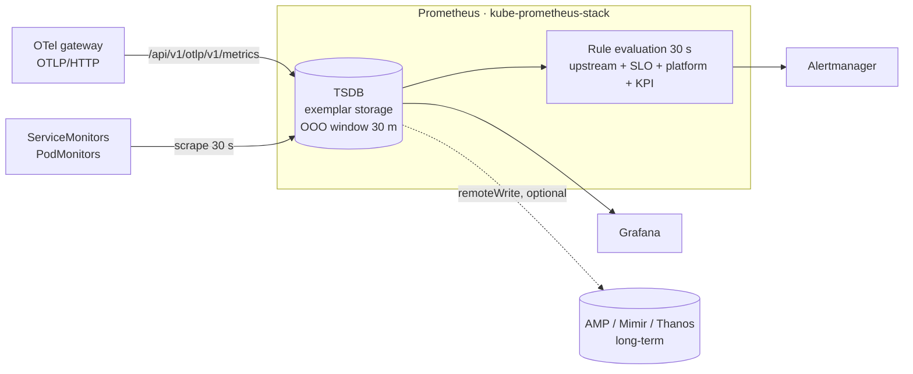
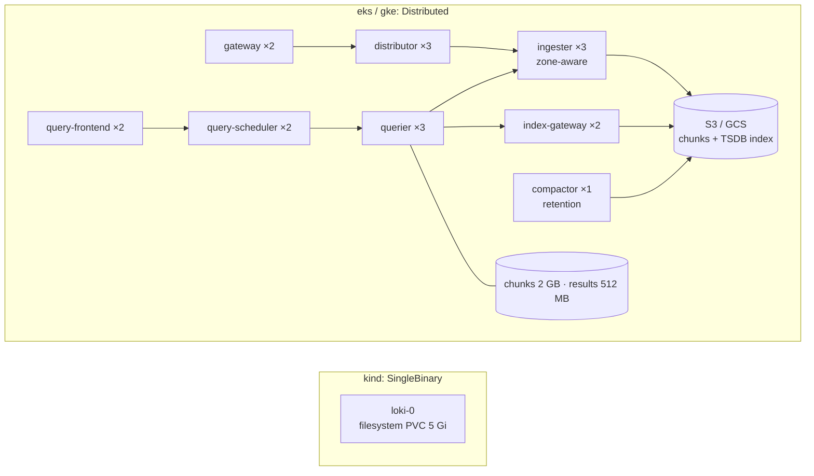
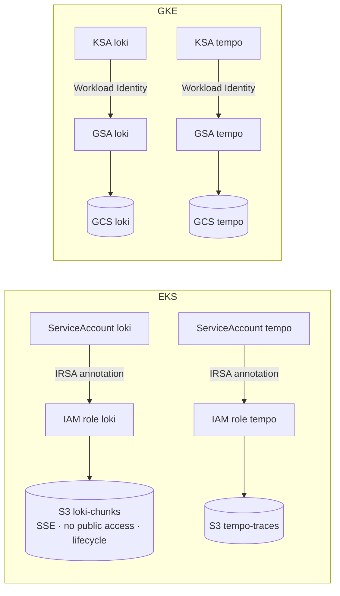

# 4. Backends & storage

| Signal | Backend | Ingest | Query | Storage | Retention (cloud / kind) |
|---|---|---|---|---|---|
| Metrics | **Prometheus** (Operator) | scrape + native OTLP receiver | PromQL, `kps-prometheus:9090` | PVC (gp3 / pd) | 15 d (18 GB cap) / 3 d (4 GB) |
| Logs & events | **Loki** | native OTLP `loki-gateway/otlp` | LogQL, `loki-gateway` | Object storage (S3/GCS) + TSDB index | 31 d / 72 h |
| Traces | **Tempo** | OTLP gRPC `tempo(-distributor):4317` | TraceQL, `tempo-query:3200` | Object storage (S3/GCS) | 14 d / 72 h |
| Alerts | **Alertmanager** | from Prometheus | `kps-alertmanager:9093` | PVC | silences, notification log |

## 4.1 Prometheus

* **Operator-managed.** Rules and scrape targets are CRDs (`PrometheusRule`, `ServiceMonitor`, `PodMonitor`, `Probe`, `ScrapeConfig`) discovered in every namespace and release, so brownfield workloads are picked up without changes.
* **HA in the cloud:** 2 identical replicas (a pair, not sharded) spread across zones, PDB `minAvailable: 1`. Grafana queries either; Alertmanager de-duplicates.
* **Exemplars** link histogram buckets to trace IDs (`exemplarTraceIdDestinations` → Tempo).
* **Long-term storage** is prepared, not enabled: uncomment `remoteWrite` in `values-eks.yaml` (Amazon Managed Prometheus with SigV4) or point it at Mimir/Thanos Receive.

## 4.2 Loki

* **Schema:** TSDB, v13, 24 h index period.
* **Structured metadata** on (trace/span IDs), **pattern ingester** on (log pattern detection in Grafana's Explore Logs), volume API on.
* **Limits:** 16 MB/s ingestion (burst 32), 20 000 streams per tenant. The index label set is kept small on purpose (cluster, environment, node + defaults).
* **Single tenant** (`auth_enabled: false`). Multi-tenancy = enable auth and set `X-Scope-OrgID` in the gateway exporter and the datasource.
* **Retention** by the compactor (`retention_enabled`); buckets additionally expire objects after retention + 7 days (Terraform lifecycle rule) as a safety net.

## 4.3 Tempo

* **kind:** chart `tempo` (monolithic), local disk, 72 h.
* **eks/gke/existing:** chart `tempo-distributed` (the root env file swaps the chart): distributor ×2, ingester ×3 (PVC 20 Gi), querier ×2, query-frontend ×2, compactor (14 d block retention), memcached.
* **Stable query endpoint:** the `tempo-query` Service (ExternalName, [`observability-config`](../gitops/observability-config/base/tempo-query-service.yaml)) points to `tempo` or `tempo-query-frontend` depending on the overlay, so the Grafana datasource never changes.
* Tempo's own metrics-generator is **not** used: RED metrics come from the OTel gateway (backend-agnostic, pre-sampling).

## 4.4 Object storage and cloud identity

No static access keys exist anywhere. Terraform ([`storage.tf`](../terraform/envs/eks/storage.tf)) creates one bucket and one role/service account per store, scoped to that bucket, and outputs the names to paste into `gitops/platform/{loki,tempo}/values-<env>.yaml`.

## 4.5 Other stateful components

| Component | State | kind | Cloud |
|---|---|---|---|
| Alertmanager | silences, notification log | 1 replica | 3-node mesh, PVC 5 Gi, PDB `minAvailable: 2` |
| Grafana | users, sessions (dashboards come from Git) | SQLite | 2 replicas; external PostgreSQL recommended (commented in `values-<env>.yaml`) |
| Keycloak | realm, users, sessions | dev mode, H2 in memory, re-imported each start | 2 replicas, PostgreSQL (`keycloak-db` secret), clustered via jdbc-ping |
| Argo CD | none of value (Git is the state); redis cache | 1 replica each | HA: redis-ha, 2× server / repo-server / applicationset |
| cert-manager | issued certificates (Secrets), ACME account | lab CA | Let's Encrypt account key |
