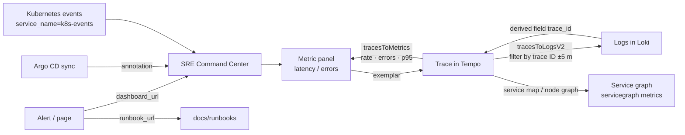

# 5. Visualisation & correlation

## 5.1 Grafana

* Deployed by kube-prometheus-stack (`grafana` Service, `https://grafana.<domain>`).
* **Everything provisioned from Git:** datasources (sidecar, label `grafana_datasource`), dashboards (sidecar, label `grafana_dashboard`, folder from the `grafana_folder` annotation). UI edits to provisioned dashboards are disabled (`allowUiUpdates: false`); change the generator and commit.
* **Access:** Keycloak SSO (`auth.generic_oauth`, PKCE) with group → role mapping; local `admin` kept for break-glass; anonymous access off; viewers cannot edit.
* Feature toggles: `traceToMetrics`, `correlations`; unified alerting is on but alert *rules* live in Prometheus (one source of truth).

## 5.2 Datasources

| Name / UID | Type | URL | Wiring |
|---|---|---|---|
| Prometheus / `prometheus` | prometheus | `kps-prometheus:9090` | Exemplars → Tempo (`trace_id`) |
| Alertmanager | alertmanager | `kps-alertmanager:9093` | Alert list panels |
| Loki / `loki` | loki | `loki-gateway` | Derived field `trace_id` → Tempo |
| Tempo / `tempo` | tempo | `tempo-query:3200` | traces → logs (Loki), traces → metrics (Prometheus), service map (Prometheus), node graph |

Defined in [`observability-config/base/datasources.yaml`](../gitops/observability-config/base/datasources.yaml) and the kube-prometheus-stack values.

## 5.3 Correlation graph

What makes each hop possible:

| Hop | Requirement |
|---|---|
| metric → trace | span-metrics connector emits exemplars; Prometheus `exemplar-storage` |
| trace → logs | logs carry the same `trace_id` (JSON log line, lifted by the agent) and the same `service_name` / namespace |
| log → trace | `trace_id` stored as Loki structured metadata |
| trace → metrics | identical `service.name` on spans and span-metrics |
| deploy → graph | `argocd_app_sync_total` / Argo CD annotations on dashboards |

## 5.4 Dashboards

Generated as code by [`scripts/generate-dashboards.py`](../scripts/generate-dashboards.py) into [`observability-config/base/dashboards/`](../gitops/observability-config/base/dashboards/); CI fails if the JSON is stale.

| Dashboard | Audience | Window | Sections |
|---|---|---|---|
| **Executive Overview** (`/d/executive-overview`, folder *Executive*) | Stakeholders, management | 30 d, refresh 5 min | Reliability at a glance · Service level objectives · Demand (requests, orders, revenue) · Delivery performance (DORA) · Cost & capacity (OpenCost) |
| **SRE Command Center** (`/d/sre-command-center`, folder *SRE*) | On-call, platform engineers | 3 h, refresh 30 s | Situation (firing alerts, burn rates) · Golden signals per `$service` with exemplars · Kubernetes workloads per `$namespace` · Nodes & capacity · Logs & Kubernetes events · Traces (failed and slow) · GitOps (Argo CD) |
| **Telemetry Pipeline Health** (folder *SRE*) | Platform team | — | OpenTelemetry collectors (accepted/refused/dropped, queue fill, export failures) · Backends (ingestion, availability) |
| ~30 upstream dashboards | Everyone | — | Kubernetes compute, networking, nodes, API server, etcd, CoreDNS (kube-prometheus-stack); Loki's own (*Platform / Loki*) |

The Executive dashboard reads mostly **recording rules** (`slo:*`, `platform:*`, `namespace:cost_*`, `cluster:*`), so its 30-day panels stay fast. The few raw queries are daily or weekly counters (`increase(...[24h])` of requests, orders and revenue, Argo CD sync totals). See [SLOs](06-slo-alerting-incidents.md) and [Cost](11-cost-integrations.md) for the rule definitions.
