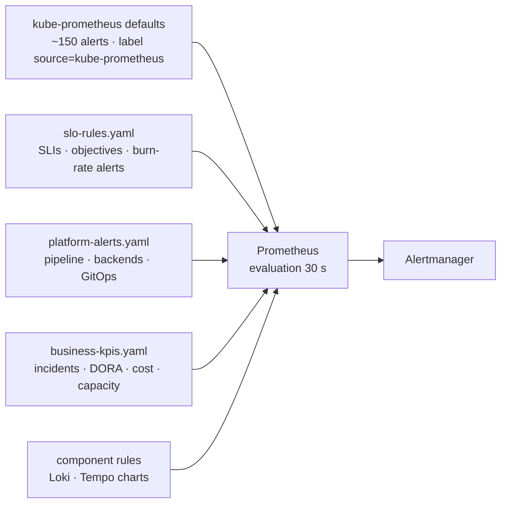
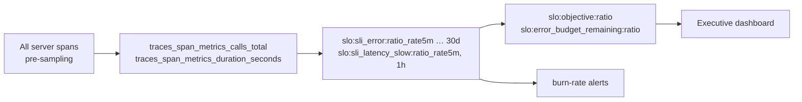
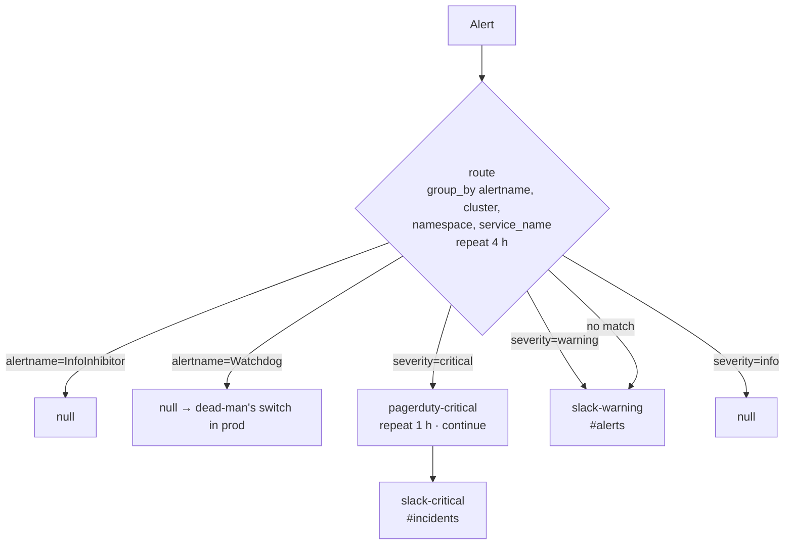
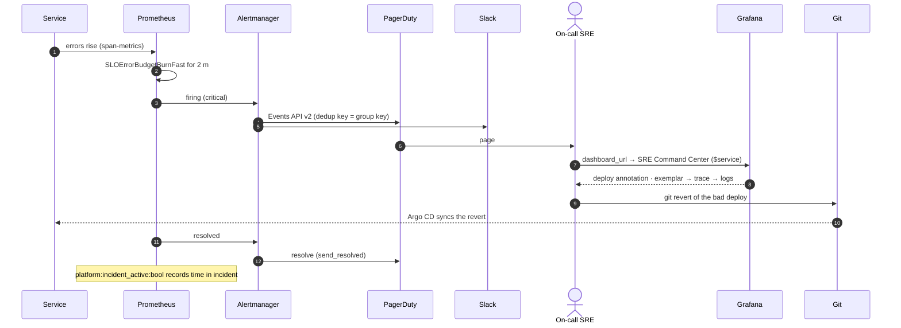

# 6. SLOs, alerting & incidents

## 6.1 Rule sources

Our rules live in [`gitops/observability-config/base/rules/`](../gitops/observability-config/base/rules/) and are checked by `promtool` in CI. Each of our alerts carries `runbook_url` (a file in [docs/runbooks](../docs/runbooks)) and `dashboard_url`.

## 6.2 SLO model

Every service that emits **server spans** gets two SLOs automatically, with no per-service configuration. The SLI is computed from span-metrics, grouped by `(k8s_namespace_name, service_name)`.

| SLO | Objective | SLI (good events) | Error budget | Window |
|---|---|---|---|---|
| Availability | 99.5 % | server spans without `STATUS_CODE_ERROR` | 0.5 % | 30 d |
| Latency | 99 % | server spans faster than 500 ms (`le="0.5"` bucket) | 1 % | 30 d |

Recording rules: error ratios for 5 m, 30 m, 1 h, 2 h, 6 h, 1 d, 3 d (every 30 s) and 30 d (every 5 min); `slo:error_budget_remaining:ratio = 1 − error_ratio_30d / (1 − objective)`; helpers `service:requests:rate5m` and `service:latency_p95:seconds_rate5m`.

## 6.3 Burn-rate alerts

Multi-window, multi-burn-rate alerts (Google SRE Workbook, chapter 5). Both windows must exceed the threshold: the long window proves significance, the short window makes the alert resolve quickly after recovery.

| Alert | Windows | Threshold | Meaning | For | Severity |
|---|---|---|---|---|---|
| `SLOErrorBudgetBurnFast` | 1 h and 5 m | 14.4 × 0.5 % | 2 % of the monthly budget in 1 h | 2 m | critical |
| `SLOErrorBudgetBurnMedium` | 6 h and 30 m | 6 × 0.5 % | 5 % of the budget in 6 h | 5 m | critical |
| `SLOErrorBudgetBurnSlow` | (1 d and 2 h) or (3 d and 6 h) | 3× / 1× | 10 % of the budget in 3 d | 15 m | warning |
| `SLOLatencyBudgetBurn` | 1 h and 5 m | 14.4 × 1 % | latency budget burning fast | 5 m | warning |

The fast, medium and latency alerts also require `service:requests:rate5m > 0.05` (more than one request every 20 s), so a single failure on an idle service cannot page anyone.

## 6.4 Platform alerts

| Group | Alert | Condition | For | Severity |
|---|---|---|---|---|
| telemetry-pipeline | `OTelCollectorDown` | an agent/gateway/cluster target is down | 5 m | critical |
| | `OTelCollectorExportFailures` | failed exports > 0 | 10 m | warning |
| | `OTelCollectorQueueNearlyFull` | sending queue > 80 % | 5 m | critical |
| | `OTelCollectorRefusingData` | receivers refusing (memory limiter) | 10 m | warning |
| observability-backends | `LokiUnavailable` | Loki targets down | 5 m | critical |
| | `TempoUnavailable` | Tempo targets down | 5 m | warning |
| | `PrometheusOTLPIngestionStalled` | no OTLP samples arriving | 15 m | warning |
| gitops | `ArgoCDAppDegraded` | app health Degraded/Missing | 15 m | critical |
| | `ArgoCDAppOutOfSync` | app OutOfSync | 30 m | warning |
| | `ArgoCDSyncFailed` | a sync failed in the last 15 m | — | warning |

Plus the kube-prometheus defaults (nodes, pods, workloads, volumes, API server, etcd, Prometheus/Alertmanager self-monitoring, `Watchdog`, `InfoInhibitor`) and the Loki/Tempo chart rules.

## 6.5 Alertmanager routing

| Inhibition | Effect |
|---|---|
| critical → warning/info (same labels) | One notification per broken thing |
| warning → info | |
| `InfoInhibitor` → info | Silence info alerts generally |
| `KubeNodeNotReady` → `KubePod.*`, `TargetDown` | A dead node does not page for every pod on it |

Receiver credentials (PagerDuty routing key, Slack webhook, optional heartbeat URL) are files mounted from the `alertmanager-incident-secrets` Secret (`*_file` settings), never in the config. `amtool` validates the rendered config in CI. Messages carry the title, severity, service, namespace, summary, runbook and dashboard links.

## 6.6 Incident lifecycle

Severity policy, PagerDuty/Slack setup and the dead-man's switch are described in [docs/incident-management.md](../docs/incident-management.md).
