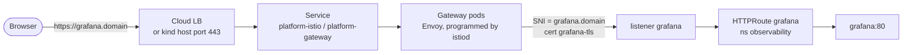
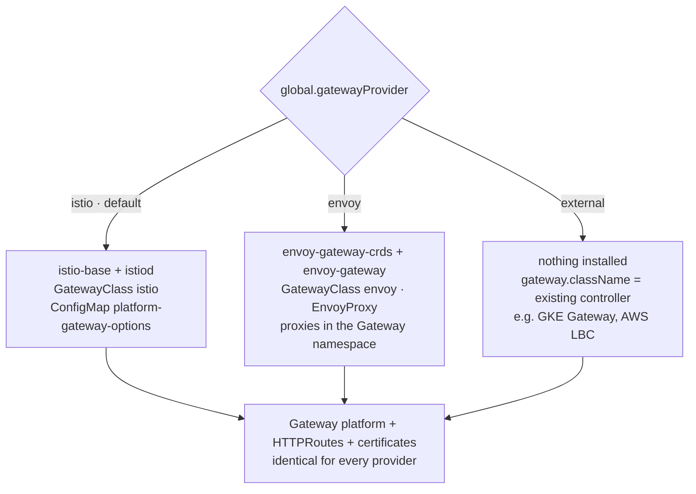
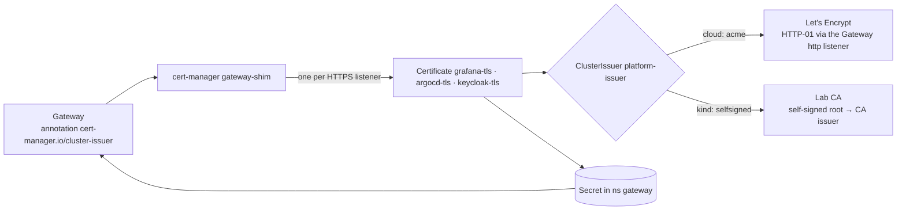
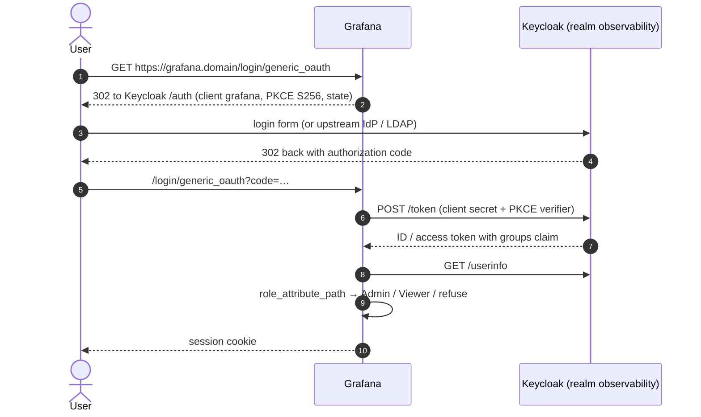
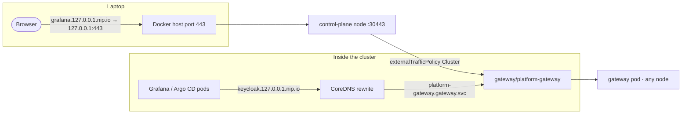

# 7. Access: ingress, TLS & SSO

## 7.1 What is exposed

| URL | Backend | Authentication |
|---|---|---|
| `https://grafana.<domain>` | `observability/grafana:80` | Keycloak SSO; local admin as break-glass |
| `https://argocd.<domain>` | `argocd/argocd-server:80` | Keycloak SSO; local admin as break-glass |
| `https://keycloak.<domain>` | `keycloak/keycloak-http:80` | Keycloak itself (realm `observability`, admin console) |
| `http://*.<domain>` | redirect | 301 → HTTPS |

**Not exposed:** Prometheus, Alertmanager, OpenCost UI, Loki, Tempo, collectors. They have no authentication of their own. Users query them through Grafana; operators use `make ui` (port-forward).

## 7.2 Request path



* **One Gateway** (`gateway/platform`): an HTTP listener on `*.<domain>` (redirect + ACME challenges) and **one HTTPS listener per hostname**, each with its own certificate.
* **Route isolation:** each HTTPS listener accepts routes only from its app's namespace (`allowedRoutes` selector on `kubernetes.io/metadata.name`), so no other namespace can capture `grafana.<domain>`.
* Routes, listeners and certificates are generated from one list (`routes:` in [`gitops/platform/ingress/values.yaml`](../gitops/platform/ingress/values.yaml)). Adding a UI is one entry.

## 7.3 Pluggable Gateway implementation

The Gateway, its routes and cert-manager's integration are plain Gateway API (`gateway.networking.k8s.io/v1`). One setting picks the controller:

```yaml
# gitops/root/values.yaml (or values-<env>.yaml)
global:
  gatewayProvider: istio      # istio | envoy | external
```



| Concern | How it stays provider-neutral |
|---|---|
| CRDs | `gateway-api` component installs the standard channel once (v1.6.3) for every provider |
| Sizing | `infrastructure:` (replicas, resources, Service type/annotations, traffic policy) is translated to Istio's options ConfigMap or Envoy's `EnvoyProxy`, both referenced via the standard `spec.infrastructure.parametersRef` |
| kind entry point | `gateway/platform-gateway` Service with fixed node ports; its selector and target ports are filled in per provider (Istio pods listen on 80/443, Envoy Gateway on 10080/10443) |
| Which apps get deployed | Root chart renders only components tagged with the selected `gatewayProvider` |

Istio runs **only as the Gateway controller**. istiod provisions one Envoy Deployment + Service per Gateway ("automated deployment"); no namespace is labelled for sidecar injection.

## 7.4 Certificates



HTTP-01 challenge routes use an exact path match, which takes precedence over the catch-all HTTPS redirect. On kind, `make lab-ca` exports the CA to trust it locally.

## 7.5 Single sign-on



Argo CD follows the same flow with its own client (`argocd`, callback `/auth/callback`), its OIDC discovery on the issuer, and RP-initiated logout.

| Keycloak group | Grafana | Argo CD |
|---|---|---|
| `sre-team` | Admin | `role:admin` |
| `stakeholders` | Viewer | `role:readonly` |
| none | login refused (`role_attribute_strict`) | `role:readonly` (`policy.default`) |

* The realm (clients, groups, a `groups` claim mapper on each client, brute-force protection, 8 h SSO idle) is declared in [`gitops/platform/keycloak/values.yaml`](../gitops/platform/keycloak/values.yaml) and imported on first start. `${VAR}` placeholders are resolved from Keycloak's environment, so client secrets never appear in Git or in the ConfigMap.
* Client secrets are generated once by Terraform and written to both sides: `keycloak/keycloak-secrets`, `observability/grafana-oidc`, `argocd/argocd-oidc`.
* Users: two demo users on kind; in production, Keycloak federates LDAP/AD or an upstream IdP (Entra ID, Google, Okta) and maps users into the two groups.

## 7.6 kind networking



The issuer URL must be identical for the browser and for Grafana/Argo CD. Outside the cluster nip.io resolves to `127.0.0.1`; inside, a CoreDNS rewrite (Terraform, kind only) answers the same names with the gateway Service. Grafana and Argo CD skip TLS verification of the lab CA **on kind only**.

Setup, cloud prerequisites and troubleshooting: [docs/sso.md](../docs/sso.md).
