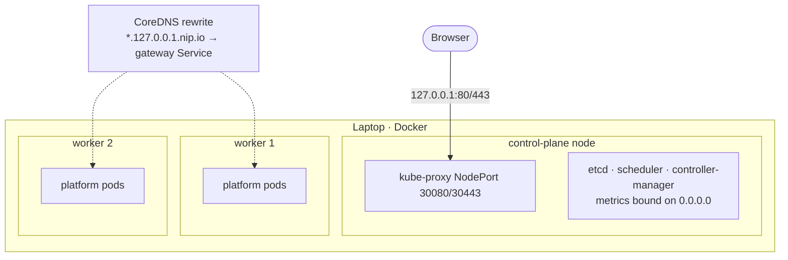
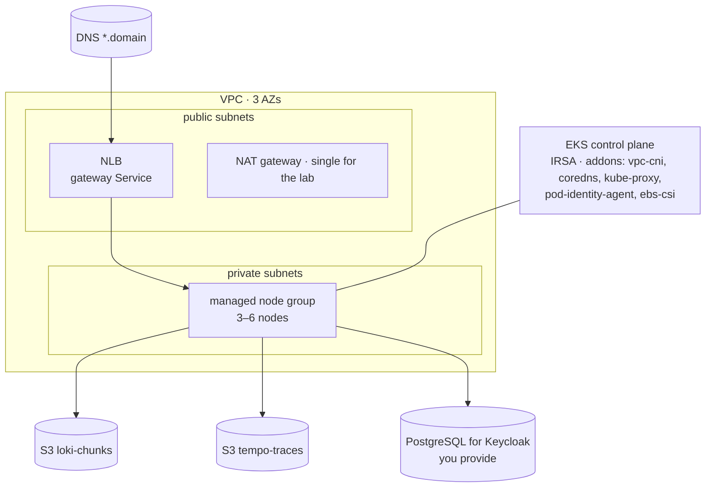
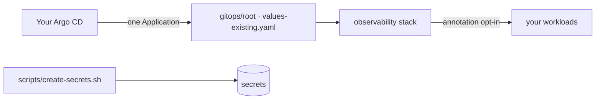

# 8. Environments & infrastructure

One Git tree, four targets. The environment name selects `values-<env>.yaml` everywhere (root catalog and every component).

## 8.1 Side by side

| | **kind** (lab) | **eks** | **gke** | **existing** (brownfield) |
|---|---|---|---|---|
| Created by | Terraform `envs/kind` (tehcyx/kind) | Terraform `envs/eks` | Terraform `envs/gke` | you |
| Nodes | 1 control plane + 2 workers | managed node group 3–6 × m6i/m6a.xlarge, private subnets | regional node pool, autoscaling | yours |
| Argo CD | installed, single replicas | HA (redis-ha, 2× server/repo-server) | HA | **your** Argo CD (`argocd` disabled) |
| Gateway | provider default (Istio), NodePort + host ports 80/443 | Istio, internet-facing NLB | Istio, external passthrough LB | disabled (bring your own) |
| TLS | lab CA (self-signed) | Let's Encrypt HTTP-01 | Let's Encrypt HTTP-01 | yours |
| Keycloak | dev mode, H2, demo users | 2 replicas, PostgreSQL (RDS) | 2 replicas, PostgreSQL (Cloud SQL) | disabled (your IdP) |
| Prometheus | 1 replica, 3 d / 4 GB | 2 replicas, 15 d, 100 Gi gp3, zone spread | 2 replicas, 15 d, 100 Gi premium-rwo | 1 replica |
| Alertmanager | 1 | 3 (mesh) | 3 | 1 |
| Loki | SingleBinary, filesystem, 72 h | Distributed, S3, 31 d | Distributed, GCS, 31 d | SingleBinary on PVC |
| Tempo | monolithic, local, 72 h | tempo-distributed, S3, 14 d | tempo-distributed, GCS | tempo-distributed, your bucket |
| OTel gateway | 1 | HPA 3–10, zone spread | HPA 3–10 | 2 |
| Control-plane metrics | etcd, scheduler, controller-manager, kube-proxy | managed (off) | managed (off) | off |
| Storage identity | — | IRSA | Workload Identity | yours |
| Demo app | on | on | on | off |

## 8.2 kind

* kubeadm patches bind control-plane metrics to `0.0.0.0` so the stack is monitored like a self-managed cluster.
* The demo image is built locally and loaded with `kind load` (no registry).
* Changing host port mappings requires recreating the cluster.
* Docker needs about 8 GB free for the full stack.

## 8.3 EKS

* `gp3` StorageClass (EBS CSI with its own IRSA role) for Prometheus, Alertmanager, Loki and Tempo ingesters.
* Buckets: SSE, public access blocked, lifecycle expiry = retention + 7 days, one IRSA role per store.
* Production hardening left to you: one NAT gateway per AZ, private API endpoint, `force_destroy = false` on buckets.

## 8.4 GKE

* VPC-native cluster (secondary ranges for pods and services), release channel, Workload Identity pool `<project>.svc.id.goog`.
* Dedicated node service account; autoscaling node pool.
* GCS buckets with a Google service account per store, bound to the Kubernetes service account via Workload Identity.
* The cloud's own Gateway controller can be used instead of Istio with `gatewayProvider: external` and `gateway.className: gke-l7-global-external-managed`.

## 8.5 Existing cluster

The platform drops in next to running workloads: it discovers ServiceMonitors/PrometheusRules from every namespace, leaves ingress, certificates and identity to you, and onboards workloads with one annotation. Options to reuse an existing Prometheus Operator or Grafana are in [docs/onboarding-existing-cluster.md](../docs/onboarding-existing-cluster.md).

## 8.6 What an environment file typically changes

| File | kind | eks / gke |
|---|---|---|
| `root/values-<env>.yaml` | `env: kind` | Tempo chart → `tempo-distributed` |
| `kube-prometheus-stack/values-<env>.yaml` | small retention, control-plane ports, Grafana URLs + lab TLS skip | HA replicas, storage class, Grafana URLs |
| `loki/` `tempo/` | filesystem / local | object storage, identity annotations, replicas |
| `otel-*/values-<env>.yaml` | — | cluster name, gateway HPA, Tempo endpoint |
| `ingress/values-<env>.yaml` | domain, NodePort, lab CA | domain, LB annotations |
| `keycloak/values-<env>.yaml` | dev mode, demo users | production mode, DB secret, replicas |
| `argocd/values-<env>.yaml` | domain, OIDC (TLS skip) | domain, OIDC, HA |
