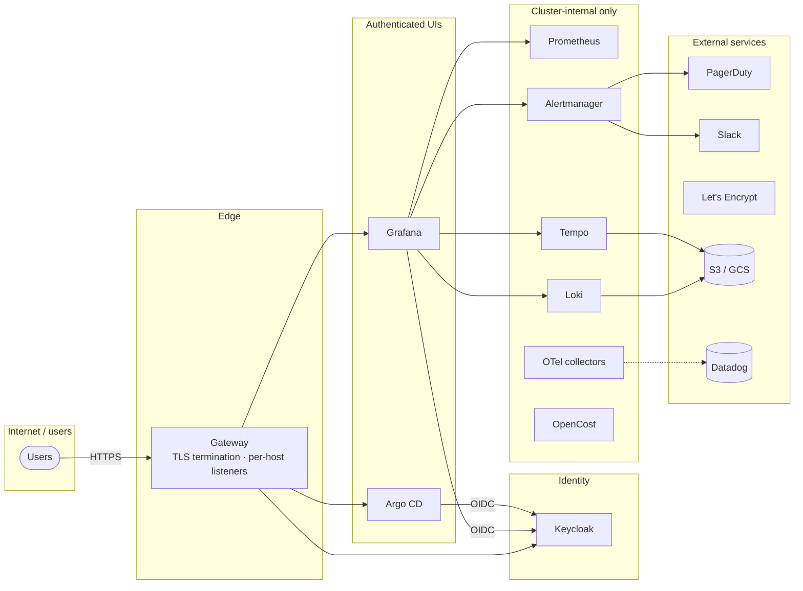

# 9. Security

## 9.1 Trust boundaries

## 9.2 Controls

| Area | Control | Where |
|---|---|---|
| **Exposure** | Only Grafana, Argo CD and Keycloak are routed; everything else is ClusterIP | `ingress/values.yaml → routes` |
| | HTTP → HTTPS redirect; per-host certificates | ingress chart, cert-manager |
| | Listener-level namespace isolation (`allowedRoutes`) | ingress chart |
| **Authentication** | SSO via OIDC; PKCE for Grafana; anonymous access off | Grafana / Argo CD values |
| | Keycloak: brute-force protection, no self-registration, `sslRequired: external` | Keycloak realm |
| **Authorisation** | Group → role (Admin/Viewer, admin/readonly); default readonly in Argo CD; Grafana refuses users without a group | Grafana `role_attribute_path`, Argo CD `policy.csv` |
| | Grafana viewers cannot edit; provisioned dashboards are read-only | Grafana ini |
| **Secrets** | Never in Git. Created by Terraform or `create-secrets.sh`; fixed names and keys so External Secrets / Vault can take over | see 9.3 |
| | Alertmanager reads credentials from files (`*_file`), not config | kube-prometheus-stack values |
| | Keycloak realm uses `${ENV}` placeholders; the ConfigMap holds no secret | Keycloak values |
| **Cloud identity** | No static keys: IRSA (EKS) / Workload Identity (GKE), one role per store scoped to its bucket | `terraform/envs/*/storage.tf` |
| | Buckets: encryption, public access blocked, lifecycle | `storage.tf` |
| **Workloads** | Demo app: non-root, seccomp `RuntimeDefault`, no privilege escalation, all capabilities dropped | `apps/demo-shop/base` |
| | `observability` is privileged only because node-exporter and the log agent need host access | Terraform namespace labels |
| **GitOps** | AppProject restricts source repositories to this repo and the charts in use | `gitops/root/templates/project.yaml` |
| | CODEOWNERS: SRE owns `gitops/` and `terraform/`, app team owns its app | `.github/CODEOWNERS` |
| | Changes only through reviewed PRs; CI never holds cluster credentials | workflows |
| **Supply chain** | Pinned chart versions, Renovate PRs, majors need approval | `gitops/root/values.yaml`, `renovate.json` |
| | Images: Trivy scan (SARIF → code scanning), SBOM + provenance | `demo-shop-ci.yaml` |
| | IaC: tflint + Trivy misconfiguration scan | `terraform.yaml` |

## 9.3 Secret inventory

| Secret | Namespace | Keys | Consumer | Created by |
|---|---|---|---|---|
| `grafana-admin` | observability | `admin-user`, `admin-password` | Grafana break-glass | Terraform / script |
| `alertmanager-incident-secrets` | observability | `pagerduty-routing-key`, `slack-webhook-url` (`heartbeat-url`) | Alertmanager | Terraform / script |
| `grafana-oidc` | observability | `client-secret` | Grafana SSO | Terraform / script |
| `argocd-oidc` (label `part-of=argocd`) | argocd | `client-secret` | Argo CD SSO | Terraform / script |
| `keycloak-secrets` | keycloak | bootstrap admin, both client secrets, demo password | Keycloak | Terraform |
| `keycloak-db` | keycloak | `KC_DB_URL_HOST`, `_DATABASE`, `_USERNAME`, `_PASSWORD` | Keycloak (cloud) | Terraform var / you |
| `gitops-repo` | argocd | token | Argo CD (private repo) | Terraform |
| `datadog-secret` | observability, datadog | `api-key`, `app-key` | Datadog exporter / agent | you |

## 9.4 Known gaps and recommendations

| Gap | Risk | Recommendation |
|---|---|---|
| Internal traffic is plain HTTP/gRPC (collectors, backends) | Sniffing inside the cluster network | NetworkPolicies per namespace; mTLS (Istio ambient or sidecars) if required |
| No NetworkPolicies shipped | Lateral movement | Restrict `observability` ingress to collectors, Grafana and Prometheus scrapes |
| Loki/Tempo single tenant | Any Grafana user with Explore sees all logs/traces | Loki/Tempo multi-tenancy + per-team datasources, or Grafana data source permissions |
| Local admins enabled | Shared credentials | Disable after SSO works (`disable_login_form`, `admin.enabled: false`) with a documented break-glass |
| Keycloak admin console on the public route | Attack surface | Restrict `/admin` to the corporate network (an extra HTTPRoute match + policy) |
| Secrets from Terraform state | State holds secret values | Remote, encrypted state; or External Secrets Operator |
| PII in logs | Compliance | OTel `transform`/`redaction` processors in the agent |
| Lab CA trust skipped on kind | None outside kind | Never copy `tls_skip_verify_insecure` / `oidc.tls.insecure.skip.verify` to other environments |
