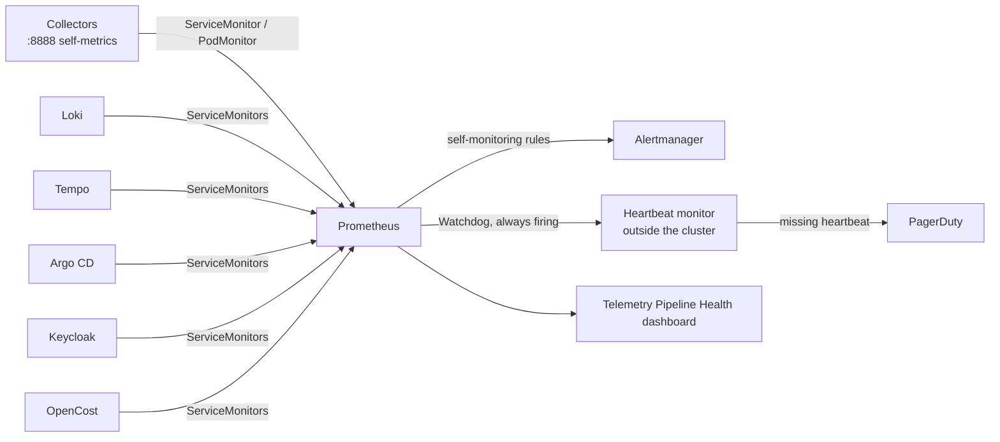

# 10. Operations & resilience

## 10.1 Who watches the watchers

The pipeline alerts (`OTelCollector*`, `LokiUnavailable`, `TempoUnavailable`, `PrometheusOTLPIngestionStalled`, `ArgoCD*`) are described in [section 6.4](06-slo-alerting-incidents.md#64-platform-alerts). If Prometheus or Alertmanager themselves die, the in-cluster alerts can't fire, so production needs the **Watchdog → external heartbeat** route ([docs/incident-management.md](../docs/incident-management.md#dead-mans-switch-production)).

## 10.2 Failure modes

| Failure | Immediate effect | Data impact | Detection | Recovery |
|---|---|---|---|---|
| One otel-agent pod | Pods on that node can't export; logs wait on disk | Spans/metrics from that node lost while down; logs resume from checkpoint | `OTelCollectorDown` | DaemonSet restarts it |
| otel-gateway replica | Agents re-balance (k8s resolver) | In-flight batches retried from agent queues | `OTelCollectorDown`, queue panels | HPA / Deployment; PDB keeps ≥1 |
| Gateway overloaded | `memory_limiter` refuses data; queues fill | Drops once queues are full | `OTelCollectorRefusingData`, `QueueNearlyFull` (critical) | HPA scales out; raise limits |
| Loki down | Gateway queues logs (5 000 batches) and retries | Loss after the queue fills | `LokiUnavailable` (critical), export failures | Restart; Distributed mode tolerates one zone (zone-aware ingesters) |
| Tempo down | Traces queued then dropped | Trace gaps; **SLOs unaffected** (span-metrics go to Prometheus) | `TempoUnavailable` | Restart |
| Prometheus down | No alerts, no dashboards | Scrape gap; OTLP pushes retried by the gateway | Watchdog heartbeat stops | HA pair in the cloud; PVC keeps history |
| Alertmanager down | No notifications | — | Watchdog heartbeat stops | 3-node mesh in the cloud |
| Grafana down | No UI | none | `TargetDown` | Stateless dashboards from Git; restart |
| Keycloak down | No new SSO logins (existing sessions continue until expiry) | none | `TargetDown`, Argo CD/Grafana login errors | Local admin break-glass; 2 replicas + DB in the cloud |
| Gateway pods / controller down | UIs unreachable from outside | none (telemetry is internal) | external uptime check recommended | Deployment restarts; port-forward (`make ui`) as fallback |
| Certificate renewal fails | Browser warnings after expiry | none | `kubectl get certificate`; cert-manager metrics | Fix DNS/ACME; certificates renew 30 days early |
| Argo CD down | No new deploys; running workloads unaffected | none | `ArgoCD*` alerts stop, `TargetDown` | Terraform re-bootstrap if lost |
| Node failure | Pods rescheduled | Agent gap on that node | `KubeNodeNotReady` (inhibits pod alerts) | Node group / pool replaces it |
| Zone failure (cloud) | Capacity drop | Loki keeps writing (zone-aware); Prometheus pair survives | node alerts | Spread constraints reschedule |

## 10.3 Capacity planning

Starting points. Measure with the Telemetry Pipeline dashboard and adjust `values-<env>.yaml`.

| Cluster size | Prometheus | Loki | OTel gateway |
|---|---|---|---|
| ≤ 20 nodes | 2 vCPU / 8 GB, 100 GB | ≤ 50 GB/day: SingleBinary is fine | 2 × (0.5 vCPU / 1 GB) |
| 20–200 nodes | 4 vCPU / 32 GB, consider sharding | Distributed | 3–10, HPA on CPU 70 % |
| > 200 nodes | Mimir/Thanos, or agent mode + remote-write | Distributed + caches | 10+ |

Cardinality guardrails already in place: span-metrics dimensions limited to method, route and status code; Loki index labels limited to cluster, environment and node; kube-state-metrics label allow-list (`app.kubernetes.io/name`, `version`, `team`, `cost-center`); Loki stream limit 20 000.

## 10.4 Scaling levers

| Pressure | Lever |
|---|---|
| Trace volume | `sample-rest` percentage, gateway HPA, `num_traces` |
| Log volume | drop/filter in the agent (`filter` processor), Loki ingestion limits, retention |
| Metric cardinality | span-metrics dimensions, `metricRelabelings`, recording rules |
| Query latency | Loki caches, query-frontend replicas, Tempo memcached |
| Long retention | Prometheus remote-write to long-term storage; object-store lifecycle |

## 10.5 Upgrades

1. Renovate opens a grouped PR on Monday; major versions wait for approval on the dependency dashboard.
2. CI renders every environment and validates schemas, collector configs, rules and Alertmanager config.
3. Optionally run the manual e2e workflow (kind) for risky upgrades.
4. Merge; Argo CD rolls the change in wave order. CRD-heavy charts use server-side apply.
5. Watch the Telemetry Pipeline dashboard and `ArgoCDAppDegraded`; roll back with `git revert`.

Coupled versions to keep in step: Argo CD chart in `gitops/root/values.yaml` **and** `terraform/modules/argocd-bootstrap/variables.tf`; Gateway API CRDs ≥ the minimum required by Istio/Envoy Gateway; Loki/Tempo schema changes need a new `schemaConfig` entry, never an edit.

## 10.6 Backup and disaster recovery

| What | State | Recovery |
|---|---|---|
| Platform configuration | Git | Re-run Terraform → Argo CD rebuilds everything |
| Logs, traces | Object storage (versioning optional) | New cluster re-attaches the same buckets |
| Metrics | Prometheus PVCs | Remote-write to long-term storage if metrics must survive the cluster |
| Keycloak realm & users | PostgreSQL (cloud) | Database backups (RDS / Cloud SQL automated backups); realm definition also in Git |
| Grafana users/preferences | SQLite / PostgreSQL | Dashboards are in Git; use PostgreSQL + backups for user data |
| Secrets | Terraform state / secret manager | Re-apply Terraform, or External Secrets |

RPO for configuration is zero (Git). The recovery time is roughly the time to create a cluster plus one full sync (about 10–15 minutes on kind).

## 10.7 Runbooks

| Runbook | For |
|---|---|
| [slo-error-budget-burn.md](../docs/runbooks/slo-error-budget-burn.md) | `SLOErrorBudgetBurn*` |
| [slo-latency.md](../docs/runbooks/slo-latency.md) | `SLOLatencyBudgetBurn` |
| [telemetry-pipeline.md](../docs/runbooks/telemetry-pipeline.md) | `OTelCollector*`, backend availability |
| [argocd-app-unhealthy.md](../docs/runbooks/argocd-app-unhealthy.md) | `ArgoCD*` |
| [docs/sso.md → Troubleshooting](../docs/sso.md#troubleshooting) | Gateway, certificates, SSO |

Game days: `make chaos-errors` (20 % payment failures → fast burn page), `make chaos-latency` (+800 ms → latency alert, slow traces), `make chaos-reset`.
