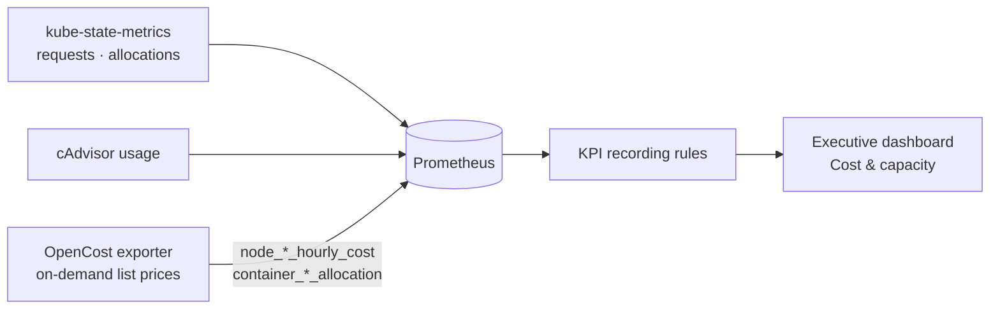
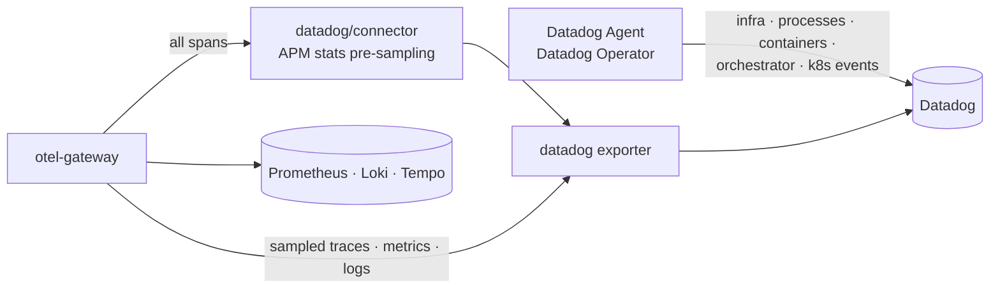

# 11. Cost & integrations

## 11.1 Cost allocation (OpenCost)

* OpenCost (CNCF incubating) reads Prometheus and publishes cost metrics that Prometheus scrapes back. On-demand list prices by default; connect cloud billing (`opencost.cloudIntegrationSecret`) for discounted, exact numbers.
* Namespace labels `team` and `cost-center` (e.g. `demo` → `cost-center: ecommerce`) are allow-listed in kube-state-metrics, so cost can be attributed to owners. Label your namespaces the same way.

| Recording rule | Definition |
|---|---|
| `platform:cluster_cost:monthly` | `sum(node_total_hourly_cost) × 730` |
| `namespace:cost_compute:monthly` | CPU allocation × node CPU price + memory allocation × node RAM price, per namespace, monthly |
| `platform:cost_idle:ratio` | `1 − Σ namespace cost / cluster cost` (paid-for but unallocated capacity) |
| `cluster:{cpu,memory}_requests:ratio` | requested / allocatable |
| `cluster:{cpu,memory}_usage:ratio` | used / allocatable |

## 11.2 Other KPIs

| Rule | Meaning | Feeds |
|---|---|---|
| `platform:incidents_open:count` | distinct critical alert groups firing | Executive: open incidents |
| `platform:incident_active:bool` | 1 while any critical fires (integrated → time in incident) | Executive |
| `platform:deployments:increase1d` | successful Argo CD syncs per day | DORA deploy frequency |
| `platform:deployments_failed:increase1d` | failed syncs per day | DORA change-failure rate |
| `shop_orders_total`, `shop_revenue_usd_total` | business counters from the demo app (OTel SDK metrics) | Demand row |

## 11.3 Cost of the platform itself

| Lever | Effect |
|---|---|
| Tail sampling (errors + slow + 25 %) | Trace storage ≈ a quarter, no loss of incident data |
| Span-metrics instead of storing all traces | SLOs and RED metrics at metric cost |
| Object storage for logs and traces | Cheapest tier; lifecycle expiry |
| Small Loki index | Low index size; queries use structured metadata |
| Noise filter (health checks, `/metrics`) | Drops spans that never matter |
| One agent per node for all signals | No duplicate DaemonSets |

## 11.4 Datadog (optional second destination)

* **Off by default.** Enable `datadog-operator` and `datadog-agent` in the root env file and add `values-datadog.yaml` to `otel-gateway.extraValueFiles`; create `datadog-secret`.
* OTel remains the only instrumentation; Datadog receives the same data as the CNCF backends. APM statistics are computed from **all** spans by the Datadog connector, so they are exact despite tail sampling.
* The Datadog Agent adds what OTel does not cover there (live processes/containers, orchestrator explorer); APM and log collection in the agent are disabled to avoid double ingestion.

## 11.5 Swapping components

| To replace | Change | Unchanged |
|---|---|---|
| Tempo → Jaeger v2 | `otlp/tempo` exporter + Grafana datasource | Instrumentation, sampling, SLOs |
| Loki → OpenSearch/ClickHouse | `otlphttp/loki` exporter + datasource | Collectors, log parsing |
| Prometheus → Mimir / managed | `remoteWrite` or OTLP endpoint | Rules (PromQL), dashboards |
| PagerDuty → Opsgenie / incident.io / Grafana IRM | Alertmanager receiver | Routing, grouping, runbooks |
| Keycloak → Entra ID / Okta / Google | Disable `keycloak`; IdP URLs in Grafana and Argo CD values | Group → role mapping (claim name `groups`) |
| Istio → Envoy Gateway / cloud controller | `global.gatewayProvider` | Gateway, routes, certificates, DNS |
| Add a commercial APM | Another exporter in the gateway | Everything upstream |
