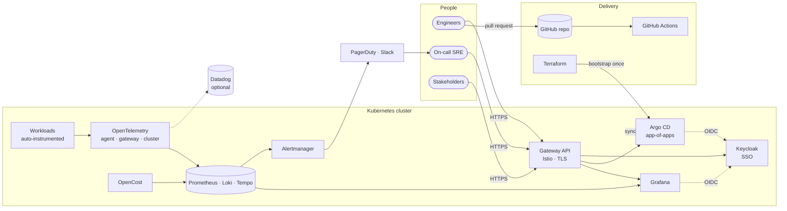

# Architecture — Observability Platform

This folder is the reference architecture of the platform: what runs, how the pieces connect, why they were chosen, and how the system behaves when things go wrong. Every statement maps to configuration in this repository; file paths are given so you can check.

## The platform in one picture

**In one sentence:** Terraform creates a cluster and installs Argo CD once; Argo CD then deploys everything else from Git, in waves. Workloads are instrumented with one annotation. OpenTelemetry collects metrics, logs, traces and Kubernetes events into Prometheus, Loki and Tempo. Grafana correlates them, SLO rules page through Alertmanager, and people reach the UIs through one HTTPS Gateway with Keycloak single sign-on.

## Documents

| # | Document | Read it to understand |
|---|---|---|
| 1 | [Overview](01-overview.md) | Goals, principles, the full component catalog, namespaces, layers |
| 2 | [Delivery & GitOps](02-delivery-gitops.md) | Terraform bootstrap, app-of-apps, sync waves, value layering, CI/CD, rollback |
| 3 | [Telemetry pipeline](03-telemetry-pipeline.md) | The three collectors, every signal path, enrichment, sampling, back-pressure, onboarding |
| 4 | [Backends & storage](04-backends-storage.md) | Prometheus, Loki, Tempo: topology, retention, object storage, identity |
| 5 | [Visualisation & correlation](05-visualisation-correlation.md) | Grafana, datasources, metric ⇄ trace ⇄ log navigation, dashboards |
| 6 | [SLOs, alerting & incidents](06-slo-alerting-incidents.md) | SLO maths, alert catalog, Alertmanager routing, incident lifecycle |
| 7 | [Access: ingress, TLS & SSO](07-access-ingress-sso.md) | Gateway API and pluggable providers, certificates, Keycloak OIDC, roles |
| 8 | [Environments & infrastructure](08-environments-infrastructure.md) | kind, EKS, GKE and existing clusters, side by side |
| 9 | [Security](09-security.md) | Trust boundaries, secrets, identity, RBAC, supply chain, known gaps |
| 10 | [Operations & resilience](10-operations-resilience.md) | Meta-monitoring, failure modes, capacity, upgrades, backup |
| 11 | [Cost & integrations](11-cost-integrations.md) | OpenCost, KPIs, Datadog dual-shipping, swapping tools |

Decisions and their alternatives are recorded in [docs/adr/0001-technology-choices.md](../docs/adr/0001-technology-choices.md). Hands-on guides live in [docs/](../docs/) (SSO setup, onboarding an existing cluster, incident management, runbooks).

## Conventions in these documents

* Diagrams are [Mermaid](https://mermaid.js.org/) and render on GitHub and in most IDEs.
* *Wave* means the Argo CD sync wave (lower first).
* `<env>` is one of `kind`, `eks`, `gke`, `existing`; `<domain>` is the platform's base domain (`127.0.0.1.nip.io` on kind).
* Numbers (replicas, retention, sizes) are the defaults in Git; each environment can override them in `values-<env>.yaml`.
