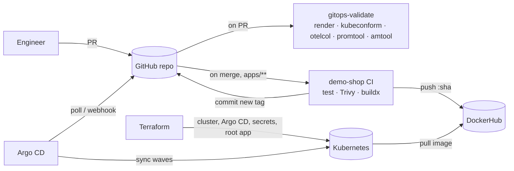
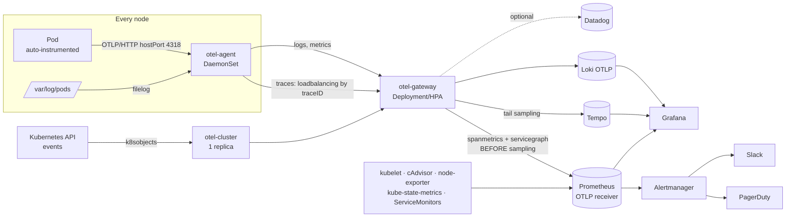

# Architecture

## 1. Delivery flow (GitOps)

* **Terraform** creates infrastructure and does the **one-time bootstrap**: namespaces, secrets, Argo CD and the root Application. After that, Terraform is out of the loop.
* **Argo CD** renders `gitops/root`, a Helm chart that emits one `Application` per enabled component. Each component combines the upstream chart (pinned) with `values.yaml` and `values-<env>.yaml` from this repo (multi-source Applications).
* **Sync waves** order the rollout:

| Wave | Components |
|---|---|
| -10 | argocd (self-management) |
| 0 | kube-prometheus-stack (CRDs, Prometheus, Alertmanager, Grafana) |
| 1 | loki, tempo, otel-operator |
| 2 | otel-gateway, opencost |
| 3 | otel-agent, otel-cluster |
| 4 | observability-config (dashboards, rules, datasources, Instrumentation) |
| 5 | demo-shop |

* **CI never talks to the cluster.** It changes Git, and Argo CD reconciles. Every deployment is therefore a Git commit, which gives an audit trail and `git revert` rollback. Argo CD sync metrics feed the DORA panels.

## 2. Telemetry flow

### Why three collectors?

| Collector | Kind | Responsibility |
|---|---|---|
| **otel-agent** | DaemonSet | Node-local OTLP endpoint (no cross-node hops), tails container logs with checkpoints, adds k8s metadata (`k8sattributes`), parses JSON logs and lifts `trace_id` for log → trace links |
| **otel-gateway** | Deployment + HPA | Central policy point: computes **RED metrics from spans** (`spanmetrics`) and the **service graph**, then **tail-samples** (keeps errors, keeps >500 ms, 25 % of the rest), and fans out to backends. Agents shard traces by trace ID (`loadbalancing` exporter), so every span of a trace reaches the same replica |
| **otel-cluster** | Deployment (1) | Signals that must be collected exactly once: Kubernetes events |

### Correlation (the "three pillars" connected)

| From | To | How |
|---|---|---|
| Metric spike (latency panel) | Exact trace | Prometheus **exemplars** from the span-metrics connector |
| Trace span | Logs of that request | Tempo `tracesToLogsV2` (filter by trace ID) |
| Trace span | Service RED metrics | Tempo `tracesToMetrics` |
| Log line | Trace | Loki `trace_id` structured metadata → derived field |
| Alert | Runbook, dashboard, query | `runbook_url`, `dashboard_url` annotations, generator URL |
| Deployment | Every graph | Argo CD sync annotations on both dashboards |

## 3. SLO model

Every service that emits server spans gets an SLO automatically (`gitops/observability-config/base/rules/slo-rules.yaml`):

* **Availability**: 99.5 % of server requests are not `STATUS_CODE_ERROR`, measured over 30 days.
* **Latency**: 99 % of server requests complete in under 500 ms.

Alerts use the Google SRE Workbook *multi-window, multi-burn-rate* method:

| Alert | Long / short window | Burn rate | Budget consumed | Severity |
|---|---|---|---|---|
| SLOErrorBudgetBurnFast | 1 h / 5 m | 14.4× | 2 % in 1 h | critical → page |
| SLOErrorBudgetBurnMedium | 6 h / 30 m | 6× | 5 % in 6 h | critical → page |
| SLOErrorBudgetBurnSlow | 1 d / 2 h and 3 d / 6 h | 3× / 1× | 10 % in 3 d | warning → Slack |

A minimum-traffic guard (> 0.05 rps) prevents pages from tiny sample sizes.

## 4. Environments

| | kind | eks / gke | existing |
|---|---|---|---|
| Loki | SingleBinary, filesystem | Distributed, S3/GCS, zone-aware ingesters | SingleBinary on PVC (upgrade path documented) |
| Tempo | monolithic, local disk | tempo-distributed, S3/GCS | tempo-distributed, your bucket |
| Prometheus | 1 replica, 3 d | 2 replicas (HA pair), 15 d, remote-write ready | 1 replica |
| Alertmanager | 1 | 3 (mesh) | 1 |
| OTel gateway | 1 | 3–10 (HPA), zone spread | 2 |
| Control-plane metrics | etcd, scheduler, controller-manager (kubeadm patches) | managed (disabled) | disabled |
| Identity | — | IRSA / Workload Identity | yours |

## 5. Capacity guidance

Starting points; measure with the Telemetry Pipeline dashboard.

| Cluster size | Prometheus | Loki ingest | OTel gateway |
|---|---|---|---|
| ≤ 20 nodes | 2 vCPU / 8 GB, 100 GB | ≤ 50 GB/day: SingleBinary is fine | 2 × (0.5 vCPU / 1 GB) |
| 20–200 nodes | 4 vCPU / 32 GB, consider sharding | Distributed | 3–10, HPA |
| > 200 nodes | Mimir/Thanos, or agent mode + remote-write | Distributed + caches | 10+ |
