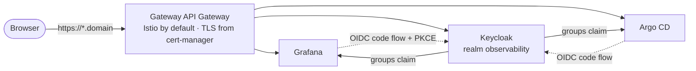

# Ingress, TLS and single sign-on

Grafana, Argo CD and Keycloak are published through one Gateway API entry point. Each has its own HTTPS hostname, and Grafana and Argo CD sign users in through **Keycloak** (OIDC). Keycloak groups decide what each user can do.

| URL | What | Login |
|---|---|---|
| `https://grafana.<domain>` | Grafana | **Sign in with Keycloak** (local `admin` = break-glass) |
| `https://argocd.<domain>` | Argo CD | **Log in via Keycloak** (local `admin` = break-glass) |
| `https://keycloak.<domain>` | Keycloak (realm `observability`, admin console) | `admin` / `make keycloak-password` |

`<domain>` is `127.0.0.1.nip.io` on kind. Replace `example.com` with your own domain on EKS and GKE.

Prometheus, Alertmanager and OpenCost have **no authentication of their own** and are deliberately **not** exposed. Query them through Grafana, or use `make ui` (port-forward) as an operator.

## How it fits together



| Component | Where | Role |
|---|---|---|
| `gateway-api` (wave -8) | `gitops/platform/gateway-api` | Gateway API CRDs (standard channel), shared by every implementation |
| `istio-base`, `istiod` (waves -7/-6) | `gitops/platform/istio-*` | Default Gateway API implementation (see [below](#gateway-implementation)) |
| `cert-manager` (wave -5) | `gitops/platform/cert-manager` | Issues one certificate per HTTPS listener (gateway-shim) |
| `ingress` (wave -4) | `gitops/platform/ingress` (local chart) | The `platform` Gateway in namespace `gateway`, the ClusterIssuer, HTTP→HTTPS redirect and one HTTPRoute per UI |
| `keycloak` (wave 1) | `gitops/platform/keycloak` | Identity provider. The realm, clients and groups are defined in `values.yaml` |
| Grafana | `kube-prometheus-stack/values*.yaml` → `auth.generic_oauth` | Relying party |
| Argo CD | `argocd/values-<env>.yaml` → `oidc.config` | Relying party |

### Roles

| Keycloak group | Grafana | Argo CD |
|---|---|---|
| `sre-team` | Admin | `role:admin` |
| `stakeholders` | Viewer | `role:readonly` |
| *(neither)* | **login refused** (`role_attribute_strict`) | `role:readonly` (`policy.default`) |

The mappings live in `grafana.ini → auth.generic_oauth.role_attribute_path` and in `argocd/values.yaml → configs.rbac.policy.csv`. Add a group in the realm and a line in each place to introduce a new role (e.g. `g, team-shop, role:shop-deployer`).

### Secrets

Client secrets are generated once by Terraform and written to **both** sides. None of them is ever in Git:

| Secret | Keys | Used by |
|---|---|---|
| `keycloak/keycloak-secrets` | `KC_BOOTSTRAP_ADMIN_USERNAME`, `KC_BOOTSTRAP_ADMIN_PASSWORD`, `GRAFANA_CLIENT_SECRET`, `ARGOCD_CLIENT_SECRET`, `DEMO_USER_PASSWORD` | Keycloak: env vars, substituted into the realm file (`${GRAFANA_CLIENT_SECRET}`) at import time |
| `observability/grafana-oidc` | `client-secret` | Grafana (`GF_AUTH_GENERIC_OAUTH_CLIENT_SECRET`) |
| `argocd/argocd-oidc` (label `app.kubernetes.io/part-of: argocd`) | `client-secret` | Argo CD (`$argocd-oidc:client-secret`) |
| `keycloak/keycloak-db` (eks/gke) | `KC_DB_URL_HOST`, `KC_DB_URL_DATABASE`, `KC_DB_USERNAME`, `KC_DB_PASSWORD` | Keycloak in production mode |

In production, manage these with External Secrets Operator, Vault or your cloud secret manager. The names and keys are the contract. To rotate a client secret, change it in Keycloak's admin console (Clients → Credentials) **and** in the relying party's secret, then restart that pod.

## kind (local)

Everything is on by default after `make up`:

```bash
make sso-users     # alice (sre-team) / bob (stakeholders) and their password
make lab-ca        # writes lab-ca.crt; trust it to get rid of the browser warning
make sso-test      # logs in as both users through Keycloak and checks their roles
```

How the lab works without public DNS or a load balancer:

* **DNS.** [nip.io](https://nip.io) resolves `*.127.0.0.1.nip.io` to `127.0.0.1`. If your router blocks DNS answers that point to private IPs, add the three hostnames to `/etc/hosts`.
* **Ports.** kind maps host `127.0.0.1:80/443` to node ports `30080/30443` of `gateway/platform-gateway`, a fixed-name Service in front of the gateway pods that works with any implementation (`localService` in the ingress chart). Changing port mappings requires recreating the cluster (`make down && make up`).
* **In-cluster DNS.** Grafana and Argo CD must call Keycloak at the same issuer URL the browser uses. Inside a pod that name would resolve to the pod itself, so Terraform adds a CoreDNS `rewrite` that answers `*.127.0.0.1.nip.io` with that same Service (`platform-gateway.gateway`).
* **TLS.** cert-manager creates a self-signed lab CA. Grafana and Argo CD skip verifying it (`tls_skip_verify_insecure`, `oidc.tls.insecure.skip.verify`), and **only on kind**.
* **Keycloak** runs in dev mode with an in-memory H2 database. The realm and the demo users are re-imported from Git on every restart, so changes made in the admin console are lost. That is intentional for a lab.

## EKS / GKE

1. **Domain.** Replace `example.com` with your domain in:
   `gitops/platform/ingress/values-<env>.yaml`, `keycloak/values-<env>.yaml`, `kube-prometheus-stack/values-<env>.yaml` (Grafana URLs) and `argocd/values-<env>.yaml`.
2. **DNS.** After the first sync, point a wildcard record `*.<domain>` at the gateway's load balancer:
   `kubectl -n gateway get gateway platform -o jsonpath='{.status.addresses[0].value}'`. Let's Encrypt certificates then issue automatically through HTTP-01 on the Gateway (`kubectl get certificate -A`).
3. **Database.** Keycloak runs in production mode (2 replicas, clustered through the database) and needs PostgreSQL. Use Amazon RDS or Cloud SQL, reachable from the cluster, with an empty `keycloak` database. Then either set the Terraform variable before `make up`:
   ```hcl
   keycloak_database = { host = "…", database = "keycloak", username = "keycloak", password = "…" }
   ```
   or create the secret yourself:
   ```bash
   kubectl -n keycloak create secret generic keycloak-db \
     --from-literal=KC_DB_URL_HOST=… --from-literal=KC_DB_URL_DATABASE=keycloak \
     --from-literal=KC_DB_USERNAME=keycloak --from-literal=KC_DB_PASSWORD=…
   ```
4. **Users.** No demo users are seeded. Either create users and assign them to `sre-team` / `stakeholders`, or (recommended) federate your directory: *User federation → LDAP / Active Directory*, or *Identity providers → OpenID Connect / SAML* (Entra ID, Google Workspace, Okta), with a mapper that puts users into the two groups.
5. **Harden.** Disable the local admins once SSO works: Grafana `auth.disable_login_form: true` and Argo CD `admin.enabled: false`, keeping a documented break-glass procedure. Consider restricting `/admin` on the Keycloak route to your corporate network.

> `--import-realm` only creates the realm if it **does not exist yet**. With a persistent database, later changes to the realm in `values.yaml` are **not** applied automatically. Make them in the admin console, or use a declarative tool such as keycloak-config-cli.

## Gateway implementation

The Gateway, its listeners, the redirect and the HTTPRoutes are plain Gateway API (`gateway.networking.k8s.io/v1`), and so is cert-manager's integration. Which controller **programs** them is a single setting in `gitops/root/values.yaml` (or a `values-<env>.yaml`):

```yaml
global:
  gatewayProvider: istio      # istio | envoy | external
```

| Provider | Installed | What the ingress chart adds |
|---|---|---|
| `istio` *(default)* | `istio-base`, `istiod`. Istio is used **only** as the Gateway controller: no namespace is labelled for sidecar injection | A ConfigMap the Gateway references (`infrastructure.parametersRef`), patching the Deployment/Service istiod creates (`platform-istio`): replicas, resources, Service type and annotations |
| `envoy` | `envoy-gateway-crds`, `envoy-gateway` (proxies run in the Gateway's namespace) | The `envoy` GatewayClass and an `EnvoyProxy` with the same settings |
| `external` | nothing | Nothing. Set `gateway.className` to a controller you already run, e.g. `gke-l7-global-external-managed` (GKE Gateway) or the AWS Load Balancer Controller's class, in `ingress/values-<env>.yaml` |

Components carry a `gatewayProvider:` tag in the catalog, and the root chart renders only those matching the selected provider. The `ingress` chart receives the same value as a Helm parameter. Data-plane sizing lives in one place, `infrastructure:` in `gitops/platform/ingress/values*.yaml`, and is translated for each implementation.

Switching on a running cluster is a commit: Argo CD prunes the old controller's Applications and the Gateway is re-programmed by the new one (a short interruption while the new proxy starts). On kind nothing else changes, because the host ports and the DNS rewrite target the provider-neutral `platform-gateway` Service. With `external` on kind, also set `localService.selector` and `targetPorts` to match that controller's pods.

## Using another Keycloak or IdP

Already running Keycloak (or Okta, Entra ID, Google) centrally? Disable the `keycloak` component in `gitops/root/values-<env>.yaml`, register two OIDC clients there with the redirect URIs below and a `groups` claim, and point the Grafana URLs and the Argo CD `issuer` at your IdP:

| Client | Redirect URI | Post-logout redirect |
|---|---|---|
| `grafana` (confidential, PKCE S256) | `https://grafana.<domain>/login/generic_oauth` | `https://grafana.<domain>/login` |
| `argocd` (confidential) | `https://argocd.<domain>/auth/callback` | `https://argocd.<domain>/*` |

Then create `grafana-oidc` and `argocd-oidc` with the client secrets (`scripts/create-secrets.sh` does it for an existing cluster).

## Troubleshooting

| Symptom | Check |
|---|---|
| Browser can't reach `*.domain` | `kubectl -n gateway get gateway platform -o yaml` (`Programmed`, listener status), `kubectl get httproute -A`, `kubectl -n gateway get endpoints platform-gateway` (kind: are the gateway pods selected?) |
| Certificate not ready | `kubectl get certificate,certificaterequest,order,challenge -A`. On the cloud, DNS must already point at the load balancer |
| Grafana "login failed" / "user has no role" | The user is in neither group. Check the `groups` claim: Keycloak → Clients → grafana → Client scopes → Evaluate |
| Argo CD "failed to query provider" | `kubectl -n argocd logs deploy/argocd-server`. On kind, check the CoreDNS rewrite: `kubectl run -it --rm dns --image=busybox -- nslookup keycloak.127.0.0.1.nip.io` |
| `invalid_redirect_uri` | Domain mismatch between the realm (`OBS_DOMAIN`) and `root_url` / Argo CD `url` |
